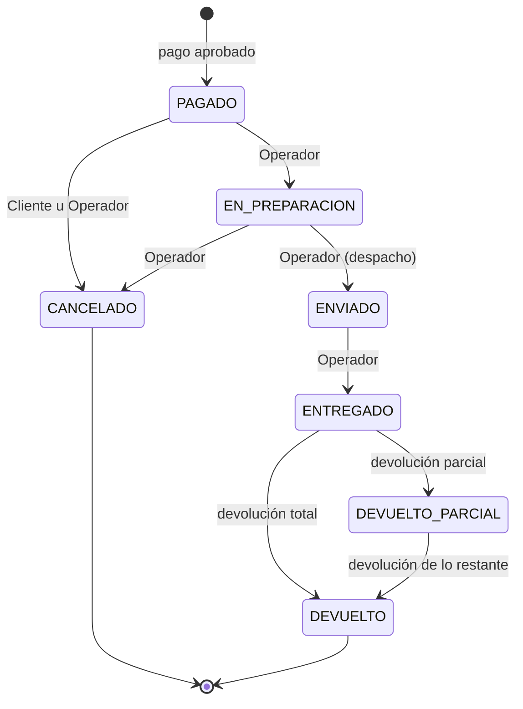

# ShopCart

Plataforma web de ventas con carrito de compras: catálogo con variantes, inventario con kardex, cupones, checkout con reserva de existencia, gestión de pedidos y devoluciones, dashboard y bitácora.

| Capa | Tecnología |
|---|---|
| Base de datos | Microsoft SQL Server 2019 · acceso exclusivo mediante stored procedures |
| Backend | Node.js 24 LTS · TypeScript (strict) · Express |
| Frontend | React 18+ · TypeScript |

---

## Estructura del repositorio

```
ShopCart/
  database/
    bootstrap/         Crea la BD, logins, usuarios, rol de la API y control de versiones (sysadmin)
    migrations/        Estructura: tablas, índices, tipos tabla (se aplican una sola vez)
    programmability/   Funciones, vistas, stored procedures, triggers y permisos (CREATE OR ALTER)
    seed/              Datos semilla
    tests/api/         Pruebas de permisos (se ejecutan como la API)
    tests/integridad/  Pruebas de restricciones (como el migrador; revierten sus datos)
    tests/calculos/    Pruebas de resultados de funciones y vistas (como el migrador; revierten sus datos)
    tests/procedimientos/  Pruebas de los SPs, ejecutados como la API (revierten sus datos)
    herramientas/      Utilidades de desarrollo (no forman parte del despliegue)
    deploy.ps1         Despliegue reproducible de la base de datos
  docs/                Diagrama entidad-relación, catálogo de errores y diagramas de apoyo
```

Modelo de datos: [docs/ER.md](docs/ER.md) · Errores de los stored procedures: [docs/errores.md](docs/errores.md).

---

## Requisitos

- SQL Server 2019 o superior con **autenticación mixta** y **TCP/IP habilitado**.
- `sqlcmd` en el PATH (incluido con las herramientas de SQL Server).
- Windows PowerShell 5.1 o superior.
- Una cuenta Windows con rol `sysadmin` en la instancia (solo para el bootstrap).
- Node.js 24 LTS.

---

## Instalación

### 1. Base de datos

```powershell
cd database
Copy-Item .env.example .env
# Edita .env: servidor (SQL_SERVER) y contraseñas de los logins shopcart_migrator y shopcart_api

.\deploy.ps1 -Bootstrap   # una vez, con una cuenta sysadmin: BD, logins, usuarios y permisos
.\deploy.ps1              # aplica migraciones, objetos programables y semillas
.\deploy.ps1 -Probar      # pruebas de permisos, integridad, cálculos y stored procedures
```

Para reconstruir la base desde cero en desarrollo: `.\deploy.ps1 -Bootstrap -Recrear` y luego `.\deploy.ps1`.

---

## Decisiones técnicas

### Seguridad de la base de datos: mínimo privilegio

| Login | Permisos | Uso |
|---|---|---|
| Cuenta Windows del instalador | `sysadmin` | Solo el bootstrap: crear la BD y los logins |
| `shopcart_migrator` | `db_owner` **solo** de ShopCart (no es sysadmin) | Crear y modificar tablas, SPs, vistas y funciones |
| `shopcart_api` (rol `RolApi`) | **Solo `EXECUTE`** sobre el esquema `dbo` | Conexión de la API |

- `RolApi` tiene `DENY SELECT, INSERT, UPDATE, DELETE` sobre `dbo`: la API no puede leer ni escribir tablas, vistas ni funciones directamente. Los stored procedures sí pueden hacerlo gracias al *ownership chaining* (SPs y tablas pertenecen a `dbo`). Así, la regla "todo el acceso a datos mediante stored procedures" la impone el motor y no solo la disciplina del código.
- Consecuencia: los SPs no usan SQL dinámico (`sp_executesql` rompe la cadena de propiedad). Los filtros opcionales y el ordenamiento se resuelven con SQL estático.
- Las contraseñas se definen en `database/.env` (excluido de Git) y llegan a `sqlcmd` por variables de entorno del proceso, nunca por la línea de comandos.

### Configuración de la base de datos

- **Collation `Modern_Spanish_100_CI_AI`**: búsquedas sin distinguir mayúsculas ni tildes ("cafe" encuentra "Café").
- **`READ_COMMITTED_SNAPSHOT ON`**: las lecturas (catálogo, reportes) no bloquean ni esperan a las escrituras (checkout). Las lecturas que deciden una escritura usan `UPDLOCK`.

### Despliegue versionado

- Scripts numerados con formato `000_Descripcion.sql`; el número es único en todo el proyecto.
- `deploy.ps1` registra cada script aplicado en `Despliegue.VersionEsquema` con su checksum SHA-256, usando stored procedures con parámetros.
- `migrations/` y `seed/` son **inmutables** una vez aplicados: un cambio se hace con un script nuevo. `programmability/` se vuelve a aplicar cuando cambia su contenido.
- Los cambios a la base se hacen **solo** con `deploy.ps1`. Volver a ejecutarlo es seguro: lo ya aplicado se omite y, si un script aplicado fue modificado, el despliegue se detiene en lugar de dejar el esquema distinto al del repositorio. Por eso las migraciones no usan `IF NOT EXISTS`: si un objeto ya existe sin estar registrado, es preferible fallar (y revertir la transacción) a ocultar la diferencia.
- El esquema `Despliegue` está separado del de la aplicación y `RolApi` no tiene acceso a él.
- `sqlcmd` se ejecuta con `QUOTED_IDENTIFIER ON` (`-I`), requerido por los índices filtrados, y lee los scripts como UTF-8.

### Integridad de datos en la base

Las reglas críticas las garantiza la base de datos, no solo la API: aunque un SP tuviera un error, el dato inválido no se guarda. La lista completa de reglas y su mecanismo está en [docs/ER.md](docs/ER.md).

- **Restricciones declarativas**: `CHECK`, `UNIQUE` (incluidos índices únicos filtrados, p. ej. un solo pago aprobado por checkout) y llaves foráneas **compuestas** que impiden cruzar datos (un cliente no puede usar la dirección de otro, una línea devuelta pertenece al pedido de su devolución, un valor "Rojo" no puede guardarse como Talla).
- **Montos** en `DECIMAL(12,2)` (nunca `FLOAT`); los totales de checkout, pedido y líneas se validan con `CHECK` (`Total = Subtotal − Descuento + CostoEnvio`, `Total = BaseImponible + IVA`). Los precios incluyen IVA (12 %).
- **Fechas** en UTC (`DATETIME2(3)`).
- **Inventario**: la existencia física solo cambia junto con un movimiento del kardex; cada movimiento cuadra (`SaldoNuevo = SaldoAnterior + Cantidad`) y nunca deja existencia negativa. Existencia disponible = física − reservas activas no vencidas, así una reserva vencida deja de contar en el mismo instante en que vence.
- **Idempotencia**: un checkout produce como máximo un pedido (`UQ_Pedido_IDCheckout`) y nunca se cobra dos veces (`UQ_Pago_CheckoutAprobado`), aun con doble clic o peticiones simultáneas.
- **Snapshot**: checkout y pedido copian precios, dirección, método de envío y cupón; editar el catálogo después no altera pedidos existentes.
- **Auditoría inmutable**: kardex, historial de precios, historial de estados y bitácora no admiten `UPDATE` ni `DELETE` (triggers `TR_*_Inmutable`). Los registros de negocio no se borran: se desactivan.
- **Pagos (PCI DSS)**: solo se guardan marca, últimos 4 dígitos, código de autorización y referencia; nunca el número completo, el CVV ni el vencimiento.

### Ciclo de vida del pedido



- Un pedido se crea solo con un pago aprobado y puede cancelarse mientras no haya sido despachado.
- Las transiciones permitidas están en la tabla `TransicionEstadoPedido`. El trigger `TR_Pedido_Estado` rechaza cualquier otra y registra cada cambio en `PedidoHistorialEstado` con usuario, fecha y hora, estado anterior y nuevo; ningún proceso puede cambiar un estado sin dejar rastro. La API valida las mismas reglas antes de llegar a la base.
- Cancelar o devolver reintegra la existencia con movimientos del kardex. Cancelar un pedido pagado revierte el uso del cupón; una devolución no.

### Funciones, vistas y tipos tabla

Son piezas internas que usan los stored procedures; la API no puede leerlas directamente (`SELECT` denegado), solo ejecuta SPs. Cada cálculo delicado existe **una sola vez**, así el carrito, el checkout y los reportes nunca calculan distinto.

| Objeto | Responsabilidad |
|---|---|
| `FU_Inventario_Disponibilidad` | Disponible = existencia física − reservas activas no vencidas. Una reserva vencida deja de contar en el mismo instante en que vence, sin depender del job de limpieza. |
| `FU_Catalogo_OrdenVariantes` | Orden lógico de las variantes según el orden de atributos de la categoría y la variante de selección inicial (la primera disponible), de la que sale el único precio del listado. |
| `FU_Carrito_Lineas` | Líneas del carrito con el precio vigente: única fuente del importe de cada línea. |
| `FU_Cupones_Validar` / `FU_Cupones_CalculoDescuento` | Reglas del cupón (vigencia, usos totales y por cliente, solo registrados, monto mínimo, categoría) con un código de error estable para cada caso, y el monto del descuento. |
| `FU_Cupones_ProrrateoDescuento` | Reparte el descuento entre las líneas con el método del mayor residuo: la suma cuadra al centavo y ninguna línea recibe más que su importe. |
| `FU_Seguridad_Actor` | Rol de quien ejecuta una acción, solo si está activo: los SPs administrativos validan el permiso aunque la API ya lo haya hecho. |
| `FU_Usuarios_ValidarDatos` | Reglas de correo, hash, nombre y teléfono con su error estable; las comparten el registro, el alta de usuarios internos y la edición del perfil. |
| `VW_Usuarios_Detalle` | Forma única en que se devuelve un usuario: nunca incluye el hash y excluye al usuario de sistema. |
| `FU_Pedidos_DesgloseIVA` | `BaseImponible = ROUND(Total / 1.12, 2)` e `IVA = Total − BaseImponible`, con la tasa tomada de `Parametro`. |
| `VW_Inventario_Conciliacion` | Por variante: existencia física vs. suma del kardex vs. último saldo, y detección de saltos en la cadena de saldos. |
| `VW_Reportes_VentasNetas` / `VW_Reportes_LineasVendidas` | Base de los reportes: qué cuenta como venta, neta de devoluciones, en hora de Guatemala. |
| Tipos `TT_*` | Envían varias filas a un SP en una sola llamada y una sola transacción (p. ej. un producto con todas sus variantes). Son parámetros tipados, no texto: no admiten inyección SQL. |

Todas las funciones son *inline*: el optimizador las integra a la consulta que las usa, así un filtro por variante o producto llega hasta el índice. Las consultas de los reportes se verificaron con volumen (20 000 pedidos): consultar un periodo lee solo las filas de ese periodo gracias a índices cubrientes.

### Stored procedures: contrato con la API

- **Plantilla común**: `SET NOCOUNT ON`, `SET XACT_ABORT ON`, validaciones antes de abrir la transacción, `TRY/CATCH` que revierte y relanza el error original (nunca se oculta).
- **Identidad desde el token**: el usuario que actúa (`@IDUsuarioSolicitante`, `@IDUsuarioAccion`) lo toma la API del JWT, nunca del cuerpo de la petición; cada SP filtra por él, así un cliente no puede ver ni modificar datos de otro cambiando un ID en la URL. Los SPs que modifican datos lo fijan en `SESSION_CONTEXT` para los triggers y la bitácora.
- **Errores con código estable**: `THROW` con un número por rango (validación, no encontrado, permiso, autenticación, conflicto) y un código como `CORREO_REGISTRADO`. La API traduce el rango a HTTP sin interpretar textos. Catálogo completo: [docs/errores.md](docs/errores.md).
- **Parámetros más largos que la columna**: los textos se declaran con un carácter más que la columna; un valor demasiado largo se rechaza en lugar de guardarse recortado en silencio.
- **Búsquedas**: filtros opcionales con SQL estático y `OPTION (RECOMPILE)`; los comodines de `LIKE` que escribe el usuario (`%`, `_`, `[`) se buscan como texto.

### Autenticación y sesiones

- **Contraseñas**: la API las procesa con Argon2id; la base solo recibe y guarda el hash (un `CHECK` rechaza cualquier otro formato). El inicio de sesión no revela si un correo está registrado.
- **Refresh token** opaco en cookie `httpOnly`; la base guarda solo su SHA-256. Se **rota en cada uso** y vence a los 7 días sin uso; aunque se use a diario, la sesión termina a los 30 días del inicio de sesión. Ambos valores están en `Parametro`, así la base es la única fuente de la regla.
- **Robo de sesión**: si se presenta un token que ya fue rotado, se asume robado y se revoca la sesión completa. Excepción: dentro de los 30 segundos siguientes a la rotación se rechaza sin cerrar la sesión, porque es el caso legítimo de dos pestañas renovando a la vez. Dos renovaciones simultáneas se serializan con un bloqueo: una rota y la otra recibe `ROTACION_CONCURRENTE`.
- **Desactivar un usuario** revoca todas sus sesiones en la misma transacción; el access token ya emitido deja de servir al vencer (máximo 15 minutos). Cambiar la contraseña cierra las demás sesiones.
- **Orden de bloqueo**: todos los SPs del módulo bloquean primero `Usuario` y después `RefreshToken`, así una desactivación simultánea a un inicio de sesión o una rotación no puede dejar una sesión viva ni producir interbloqueos.

### Reglas de los reportes

- **Venta** = pedidos cuyo estado cuenta como venta (desde `PAGADO`; excluye `CANCELADO`).
- **Monto** = mercadería: subtotal − descuento − devoluciones. El costo de envío no es venta.
- **Devoluciones**: se descuentan en la **fecha del pedido**. Así, "ventas de octubre" responde cuánto se vendió realmente en octubre, y es consistente con el top 10 y las ventas por categoría.
- **Fechas**: se guardan en UTC y los reportes agrupan por día, semana y mes en hora de Guatemala (UTC−6).

### Pruebas de la base de datos

`.\deploy.ps1 -Probar` ejecuta cuatro suites:

- `tests/api`: conectado **como la API**, verifica que solo puede ejecutar SPs, que leer o escribir una tabla se rechaza y que puede enviar tipos tabla a un SP.
- `tests/integridad`: intenta guardar datos inválidos (totales que no cuadran, doble pedido del mismo checkout, transición de estado no permitida, modificar el kardex...) y verifica que los rechace **la restricción o el trigger esperado**, identificado por su nombre.
- `tests/calculos`: verifica los resultados de funciones y vistas con datos y fechas controlados (disponibilidad con reservas vencidas, cada error de cupón, prorrateo, IVA, conciliación del kardex, ventas netas). Incluye pruebas de propiedad: 2 500 descuentos prorrateados y 20 000 totales desglosados, sin un solo centavo de diferencia.
- `tests/procedimientos`: el migrador prepara los datos y ejecuta cada SP **haciéndose pasar por la API**, así cada prueba demuestra que el SP funciona y que la API tiene permiso para usarlo. Cubre cada código de error y los casos de sesión con el tiempo simulado: rotación, dos pestañas renovando a la vez, reúso de un token robado, vencimiento por inactividad y por el máximo de 30 días, cierre de sesión y desactivación del usuario.

Todas ocurren en transacciones que se revierten: no dejan datos. En `tests/procedimientos` cada caso usa su propia transacción, porque un error dentro de un SP (`XACT_ABORT ON`) condena la transacción que lo envuelve.

---

## Credenciales de prueba

_Se documentarán al cargar los datos semilla._
