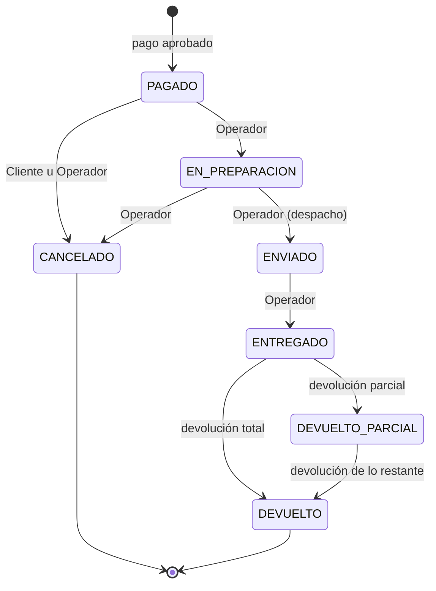

# ShopCart

Plataforma web de ventas con carrito de compras: catálogo con variantes, inventario con kardex, cupones, checkout con reserva de existencia, gestión de pedidos y devoluciones, dashboard y bitácora.

| Capa | Tecnología |
|---|---|
| Base de datos | Microsoft SQL Server 2019 · acceso exclusivo mediante stored procedures |
| Backend | Node.js 24 LTS · TypeScript (strict) · Express |
| Frontend | React 18+ · TypeScript |

---

## Estructura del repositorio

```
ShopCart/
  database/
    bootstrap/         Crea la BD, logins, usuarios, rol de la API y control de versiones (sysadmin)
    migrations/        Estructura: tablas, índices, tipos tabla (se aplican una sola vez)
    programmability/   Funciones, vistas, stored procedures, triggers y permisos (CREATE OR ALTER)
    seed/              Datos semilla
    tests/api/         Pruebas de permisos (se ejecutan como la API)
    tests/integridad/  Pruebas de restricciones (como el migrador; revierten sus datos)
    herramientas/      Utilidades de desarrollo (no forman parte del despliegue)
    deploy.ps1         Despliegue reproducible de la base de datos
  docs/                Diagrama entidad-relación y diagramas de apoyo
```

Modelo de datos: [docs/ER.md](docs/ER.md).

---

## Requisitos

- SQL Server 2019 o superior con **autenticación mixta** y **TCP/IP habilitado**.
- `sqlcmd` en el PATH (incluido con las herramientas de SQL Server).
- Windows PowerShell 5.1 o superior.
- Una cuenta Windows con rol `sysadmin` en la instancia (solo para el bootstrap).
- Node.js 24 LTS.

---

## Instalación

### 1. Base de datos

```powershell
cd database
Copy-Item .env.example .env
# Edita .env: servidor (SQL_SERVER) y contraseñas de los logins shopcart_migrator y shopcart_api

.\deploy.ps1 -Bootstrap   # una vez, con una cuenta sysadmin: BD, logins, usuarios y permisos
.\deploy.ps1              # aplica migraciones, objetos programables y semillas
.\deploy.ps1 -Probar      # pruebas de permisos (como la API) y de integridad (como el migrador)
```

Para reconstruir la base desde cero en desarrollo: `.\deploy.ps1 -Bootstrap -Recrear` y luego `.\deploy.ps1`.

---

## Decisiones técnicas

### Seguridad de la base de datos: mínimo privilegio

| Login | Permisos | Uso |
|---|---|---|
| Cuenta Windows del instalador | `sysadmin` | Solo el bootstrap: crear la BD y los logins |
| `shopcart_migrator` | `db_owner` **solo** de ShopCart (no es sysadmin) | Crear y modificar tablas, SPs, vistas y funciones |
| `shopcart_api` (rol `RolApi`) | **Solo `EXECUTE`** sobre el esquema `dbo` | Conexión de la API |

- `RolApi` tiene `DENY SELECT, INSERT, UPDATE, DELETE` sobre `dbo`: la API no puede leer ni escribir tablas, vistas ni funciones directamente. Los stored procedures sí pueden hacerlo gracias al *ownership chaining* (SPs y tablas pertenecen a `dbo`). Así, la regla "todo el acceso a datos mediante stored procedures" la impone el motor y no solo la disciplina del código.
- Consecuencia: los SPs no usan SQL dinámico (`sp_executesql` rompe la cadena de propiedad). Los filtros opcionales y el ordenamiento se resuelven con SQL estático.
- Las contraseñas se definen en `database/.env` (excluido de Git) y llegan a `sqlcmd` por variables de entorno del proceso, nunca por la línea de comandos.

### Configuración de la base de datos

- **Collation `Modern_Spanish_100_CI_AI`**: búsquedas sin distinguir mayúsculas ni tildes ("cafe" encuentra "Café").
- **`READ_COMMITTED_SNAPSHOT ON`**: las lecturas (catálogo, reportes) no bloquean ni esperan a las escrituras (checkout). Las lecturas que deciden una escritura usan `UPDLOCK`.

### Despliegue versionado

- Scripts numerados con formato `000_Descripcion.sql`; el número es único en todo el proyecto.
- `deploy.ps1` registra cada script aplicado en `Despliegue.VersionEsquema` con su checksum SHA-256, usando stored procedures con parámetros.
- `migrations/` y `seed/` son **inmutables** una vez aplicados: un cambio se hace con un script nuevo. `programmability/` se vuelve a aplicar cuando cambia su contenido.
- Los cambios a la base se hacen **solo** con `deploy.ps1`. Volver a ejecutarlo es seguro: lo ya aplicado se omite y, si un script aplicado fue modificado, el despliegue se detiene en lugar de dejar el esquema distinto al del repositorio. Por eso las migraciones no usan `IF NOT EXISTS`: si un objeto ya existe sin estar registrado, es preferible fallar (y revertir la transacción) a ocultar la diferencia.
- El esquema `Despliegue` está separado del de la aplicación y `RolApi` no tiene acceso a él.
- `sqlcmd` se ejecuta con `QUOTED_IDENTIFIER ON` (`-I`), requerido por los índices filtrados, y lee los scripts como UTF-8.

### Integridad de datos en la base

Las reglas críticas las garantiza la base de datos, no solo la API: aunque un SP tuviera un error, el dato inválido no se guarda. La lista completa de reglas y su mecanismo está en [docs/ER.md](docs/ER.md).

- **Restricciones declarativas**: `CHECK`, `UNIQUE` (incluidos índices únicos filtrados, p. ej. un solo pago aprobado por checkout) y llaves foráneas **compuestas** que impiden cruzar datos (un cliente no puede usar la dirección de otro, una línea devuelta pertenece al pedido de su devolución, un valor "Rojo" no puede guardarse como Talla).
- **Montos** en `DECIMAL(12,2)` (nunca `FLOAT`); los totales de checkout, pedido y líneas se validan con `CHECK` (`Total = Subtotal − Descuento + CostoEnvio`, `Total = BaseImponible + IVA`). Los precios incluyen IVA (12 %).
- **Fechas** en UTC (`DATETIME2(3)`).
- **Inventario**: la existencia física solo cambia junto con un movimiento del kardex; cada movimiento cuadra (`SaldoNuevo = SaldoAnterior + Cantidad`) y nunca deja existencia negativa. Existencia disponible = física − reservas activas no vencidas, así una reserva vencida deja de contar en el mismo instante en que vence.
- **Idempotencia**: un checkout produce como máximo un pedido (`UQ_Pedido_IDCheckout`) y nunca se cobra dos veces (`UQ_Pago_CheckoutAprobado`), aun con doble clic o peticiones simultáneas.
- **Snapshot**: checkout y pedido copian precios, dirección, método de envío y cupón; editar el catálogo después no altera pedidos existentes.
- **Auditoría inmutable**: kardex, historial de precios, historial de estados y bitácora no admiten `UPDATE` ni `DELETE` (triggers `TR_*_Inmutable`). Los registros de negocio no se borran: se desactivan.
- **Pagos (PCI DSS)**: solo se guardan marca, últimos 4 dígitos, código de autorización y referencia; nunca el número completo, el CVV ni el vencimiento.

### Ciclo de vida del pedido



- Un pedido se crea solo con un pago aprobado y puede cancelarse mientras no haya sido despachado.
- Las transiciones permitidas están en la tabla `TransicionEstadoPedido`. El trigger `TR_Pedido_Estado` rechaza cualquier otra y registra cada cambio en `PedidoHistorialEstado` con usuario, fecha y hora, estado anterior y nuevo; ningún proceso puede cambiar un estado sin dejar rastro. La API valida las mismas reglas antes de llegar a la base.
- Cancelar o devolver reintegra la existencia con movimientos del kardex. Cancelar un pedido pagado revierte el uso del cupón; una devolución no.

### Pruebas de la base de datos

`.\deploy.ps1 -Probar` ejecuta dos suites:

- `tests/api`: conectado **como la API**, verifica que solo puede ejecutar SPs y que leer o escribir una tabla se rechaza.
- `tests/integridad`: intenta guardar datos inválidos (totales que no cuadran, doble pedido del mismo checkout, transición de estado no permitida, modificar el kardex...) y verifica que los rechace **la restricción o el trigger esperado**, identificado por su nombre. Todo ocurre en transacciones que se revierten: no deja datos.

---

## Credenciales de prueba

_Se documentarán al cargar los datos semilla._
