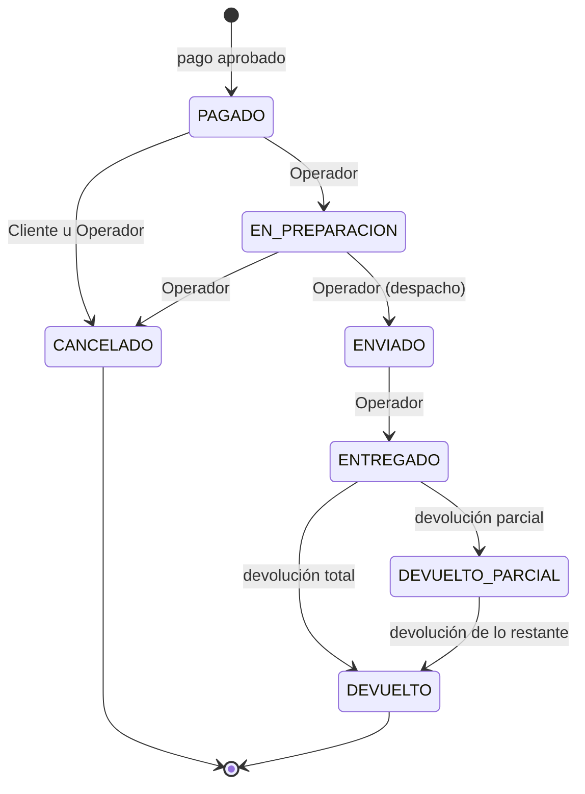

# ShopCart

Plataforma web de ventas con carrito de compras: catálogo con variantes, inventario con kardex, cupones, checkout con reserva de existencia, gestión de pedidos y devoluciones, dashboard y bitácora.

| Capa | Tecnología |
|---|---|
| Base de datos | Microsoft SQL Server 2019 · acceso exclusivo mediante stored procedures |
| Backend | Node.js 24 LTS · TypeScript (strict) · Express |
| Frontend | React 19 · TypeScript (strict) · Vite · Bootstrap 5.3 |

---

## Estructura del repositorio

```
ShopCart/
  database/
    bootstrap/         Crea la BD, logins, usuarios, rol de la API y control de versiones (sysadmin)
    migrations/        Estructura: tablas, índices, tipos tabla (se aplican una sola vez)
    programmability/   Funciones, vistas, stored procedures, triggers y permisos (CREATE OR ALTER)
    seed/              Datos semilla
    tests/api/         Pruebas de permisos (se ejecutan como la API)
    tests/integridad/  Pruebas de restricciones (como el migrador; revierten sus datos)
    tests/calculos/    Pruebas de resultados de funciones y vistas (como el migrador; revierten sus datos)
    tests/procedimientos/  Pruebas de los SPs, ejecutados como la API (revierten sus datos)
    herramientas/      Utilidades de desarrollo (no forman parte del despliegue)
    deploy.ps1         Despliegue reproducible de la base de datos
  api/
    src/               Código de la API: config, db (SPs), errores, middlewares, módulos por capas,
                       pagos (pasarela), exportes (Excel/PDF), caché, avisos y tareas programadas
    tests/             Pruebas unitarias y de integración (vitest + supertest, contra ShopCart_Pruebas)
    seed-assets/       Imágenes de los productos de la semilla (versionadas)
    scripts/           Utilidades (genera y verifica las imágenes de la semilla)
  frontend/
    src/api/           Cliente HTTP y tipos generados del OpenAPI de la API
    src/sesion/        Sesión, renovación del token, guardas y tabla de permisos por rol
    src/app/           Rutas, layouts y páginas generales
    src/ui/            Sistema de diseño (componentes reutilizables)
    src/features/      Pantallas por módulo; su lógica vive en features/*/hooks
    tests/e2e/         Pruebas de extremo a extremo (Playwright, contra la API real)
  docs/                Diagrama entidad-relación, catálogo de errores y diagramas de apoyo
```

Modelo de datos: [docs/ER.md](docs/ER.md) · Errores de los stored procedures: [docs/errores.md](docs/errores.md).

---

## Requisitos

- SQL Server 2019 o superior con **autenticación mixta** y **TCP/IP habilitado**.
- `sqlcmd` en el PATH (incluido con las herramientas de SQL Server).
- Windows PowerShell 5.1 o superior.
- Una cuenta Windows con rol `sysadmin` en la instancia (solo para el bootstrap).
- Node.js 24 LTS.

---

## Instalación

### 1. Base de datos

```powershell
cd database
Copy-Item .env.example .env
# Edita .env: servidor (SQL_SERVER) y contraseñas de los logins shopcart_migrator y shopcart_api

.\deploy.ps1 -Bootstrap   # una vez, con una cuenta sysadmin: BD, logins, usuarios y permisos
.\deploy.ps1              # aplica migraciones, objetos programables y semillas
.\deploy.ps1 -Probar      # pruebas de permisos, integridad, cálculos y stored procedures
```

Para reconstruir la base desde cero en desarrollo: `.\deploy.ps1 -Bootstrap -Recrear` y luego `.\deploy.ps1`.

Base para las pruebas de la API (idéntica, con sus semillas; las pruebas crean datos y nunca usan `ShopCart`):

```powershell
.\deploy.ps1 -Bootstrap -BaseDatos ShopCart_Pruebas
.\deploy.ps1 -BaseDatos ShopCart_Pruebas
```

### 2. API

Requiere Node.js 24.

```powershell
cd api
Copy-Item .env.example .env
# Edita .env: DB_CONTRASENA (la de shopcart_api) y JWT_SECRETO (el comando para generarlo está en el archivo)

npm install
npm run setup     # copia las imágenes de la semilla a uploads/
npm run dev       # http://localhost:3000/api/v1/health · documentación: http://localhost:3000/api/v1/docs
npm test          # pruebas unitarias y de integración (contra ShopCart_Pruebas)
```

Otros comandos: `npm run build` y `npm start` (producción), `npm run lint`, `npm run typecheck`.

### 3. Frontend

Con la API en marcha, en otra terminal:

```powershell
cd frontend
Copy-Item .env.example .env   # API_URL: dónde está la API (por defecto http://localhost:3000)
npm install
npm run dev                   # http://localhost:5173
```

| Comando | Qué hace |
|---|---|
| `npm run build` y `npm run preview` | Compila y sirve la versión de producción, con sus cabeceras de seguridad |
| `npm test` | Pruebas unitarias y de componentes |
| `npx playwright install chromium` y `npm run test:e2e` | Pruebas de extremo a extremo: levantan la API contra `ShopCart_Pruebas` y la app compilada, en escritorio y móvil |
| `npm run tipos` | Regenera los tipos de TypeScript desde el OpenAPI de la API |
| `npm run verificar` | Tipos al día, formato, lint, compilación, pruebas y build |

### Probar la API

**Probar la API**: `http://localhost:3000/api/v1/docs` (Swagger) documenta cada endpoint con sus datos de entrada, respuestas y errores, y permite ejecutarlos. Para las rutas protegidas: ejecuta `POST /auth/login` con una de las [credenciales de prueba](#credenciales-de-prueba), copia `accessToken` y pégalo en **Authorize**. La documentación se genera de los mismos esquemas que validan las peticiones, así que no puede quedar desactualizada.

**Probar una compra en Swagger**: agrega productos con `POST /carrito/items` (sin **Authorize** compras como invitado; el navegador guarda la cookie), inicia el checkout con `POST /checkout` escribiendo un UUID cualquiera en la cabecera `idempotency-key` y paga con `POST /checkout/{id}/pago` usando una de las [tarjetas de prueba](#pago-simulado). Con el `tokenSeguimiento` de la respuesta, `GET /seguimiento/{token}` muestra el pedido sin sesión; el panel (`/pedidos`) se prueba con la cuenta del operador.

---

## Documentación de la API

Base: `/api/v1`. Respuestas `{ data, meta? }`; errores `{ error: { codigo, mensaje, detalles?, requestId } }` con los códigos de [docs/errores.md](docs/errores.md). Cada endpoint, con sus datos de entrada, respuestas y errores, está en **Swagger** (`/api/v1/docs`: 98 operaciones en 79 rutas); el documento OpenAPI se genera de los mismos esquemas que validan las peticiones.

| Módulo | Endpoints | Quién |
|---|---|---|
| Autenticación | `POST /auth/registro`, `/auth/login`, `/auth/refresh`, `/auth/logout`, `/auth/cambiar-contrasena` | Público (cambiar contraseña: con sesión) |
| Perfil y usuarios | `GET/PUT /perfil`; `GET/POST /usuarios`, `PATCH /usuarios/{id}/estado` | Con sesión; usuarios: ADMIN |
| Direcciones | `GET/POST /direcciones`, `PUT/DELETE /direcciones/{id}`, `POST /direcciones/{id}/predeterminada` | CLIENTE (solo las suyas) |
| Tienda | `GET /tienda/categorias`, `/tienda/productos` (búsqueda, filtros, orden y paginación), `/tienda/productos/{slug}`, `/tienda/metodos-envio`, `/departamentos`, `/departamentos/{id}/municipios` | Público |
| Catálogo | Categorías, atributos y valores, productos con variantes, precios con historial e imágenes (29 endpoints) | ADMIN |
| Inventario | `GET /inventario/existencias`, `/inventario/kardex`, `/inventario/conciliacion`; `POST /inventario/movimientos` | OPERADOR, ADMIN |
| Carrito | `GET/DELETE /carrito`, `POST /carrito/items`, `PUT/DELETE /carrito/items/{idVariante}`, `POST/DELETE /carrito/cupon` | Cliente (token) o invitado (cookie) |
| Cupones y envíos | CRUD de `/cupones` y de `/metodos-envio` con activar/desactivar | ADMIN |
| Checkout y pago | `POST /checkout` (cabecera `Idempotency-Key`), `GET /checkout/{id}`, `POST /checkout/{id}/pago` | Cliente o invitado |
| Mis pedidos | `GET /mis-pedidos`, `/mis-pedidos/{id}`, `POST /mis-pedidos/{id}/cancelar` | CLIENTE (solo los suyos) |
| Seguimiento | `GET /seguimiento/{token}` | Público, con el enlace secreto |
| Pedidos y devoluciones | `GET /pedidos` (filtros por estado, fechas, número, correo o nombre), `GET /pedidos/{id}`, `PATCH /pedidos/{id}/estado`, `POST /pedidos/{id}/cancelar`, `POST /pedidos/{id}/devoluciones`, `GET /devoluciones` | OPERADOR, ADMIN |
| Reportes | `GET /reportes/resumen`, `/reportes/ventas`, `/reportes/ventas-por-categoria`, `/reportes/top-productos`, `/reportes/carritos-abandonados`, exportaciones Excel/PDF y `/reportes/tiempo-real` (SSE) | ADMIN |
| Bitácora y parámetros | `GET /bitacora`, `/bitacora/exportar`; `GET /parametros`, `GET/PUT /parametros/{clave}` | ADMIN |
| Sistema | `GET /health` | Público |

---

## Cumplimiento del enunciado

Cada criterio de aceptación, dónde se garantiza y qué prueba automática lo demuestra. Las pruebas SQL están en `database/tests/` (`.\deploy.ps1 -Probar`) y las de la API en `api/tests/` (`npm test`).

| Requisito | Criterio | Cómo se garantiza | Prueba |
|---|---|---|---|
| RF-01 | Contraseñas con hash seguro | Argon2id en la API; `CK_Usuario_Contrasena` solo acepta hashes | `008_Procedimientos_Seguridad.sql`, `auth.test.ts` |
| RF-01 | JWT corto y refresh con rotación | Access token de 15 min; refresh opaco que se rota en cada uso, con detección de reúso | `008_Procedimientos_Seguridad.sql`, `auth.test.ts` |
| RF-01 | Cambiar un ID en la URL o el body no expone datos de otro cliente | El usuario sale del token; cada SP filtra por él y un recurso ajeno responde igual que uno inexistente (404) | `direcciones.test.ts`, `carrito.test.ts`, `checkout.test.ts`, `pedidos.test.ts` |
| RF-01 | Token vencido → 401; sin permiso → 403 | Middleware de autenticación y roles; los SPs vuelven a validar el rol | `auth.test.ts`, `usuarios.test.ts`, `pedidos.test.ts` |
| RF-01 | Desactivar sin borrar | `Usuario.Activo`; desactivar revoca sus sesiones en la misma transacción | `008_Procedimientos_Seguridad.sql`, `usuarios.test.ts` |
| RF-02 | SKU único, atributos, precio y existencia por variante | `UQ_Variante_SKU`, FK compuesta de atributos, `CK_Variante_*` | `002_Integridad_SeguridadCatalogo.sql`, `catalogo.test.ts` |
| RF-02 | Búsqueda, filtros, orden y paginación | `SP_Tienda_*` con SQL estático y `OPTION (RECOMPILE)` | `011_Procedimientos_CatalogoTienda.sql`, `tienda.test.ts` |
| RF-02 | Productos con ventas no se eliminan | No existe un SP de borrado: se desactivan y dejan de mostrarse | `010_Procedimientos_CatalogoProductos.sql`, `catalogo.test.ts` |
| RF-02 | Un cambio de precio no altera pedidos ya realizados | El checkout y el pedido copian el precio (`PedidoDetalle.PrecioUnitario`) | `pedidos.test.ts` (se cambia el precio después de comprar) |
| RF-03 | Cada movimiento en el kardex con usuario, fecha, motivo y cantidad | La existencia solo cambia junto con su movimiento, en la misma transacción; kardex inmutable | `012_Procedimientos_Inventario.sql`, `inventario.test.ts` |
| RF-03 | Disponible = física − reservadas | `FU_Inventario_Disponibilidad` (reservas activas no vencidas) | `006_Calculos_Funciones.sql` |
| RF-03 | La existencia coincide con la suma del kardex | `CK_MovimientoInventario_SaldoCuadra`; `SP_Inventario_Conciliar` devuelve vacío si todo cuadra | `021_Integridad_Semillas.sql`, `inventario.test.ts` |
| RF-03 | Ajuste manual con motivo y sin dejar negativo | Validación del SP + `CK_MovimientoInventario_SaldoNoNegativo` | `012_Procedimientos_Inventario.sql`, `inventario.test.ts` |
| RF-04 | No agregar más que lo disponible | Tope por línea = menor entre el límite y lo disponible (409 `STOCK_INSUFICIENTE`) | `013_Procedimientos_Carrito.sql`, `carrito.test.ts` |
| RF-04 | Total sin errores de redondeo | `DECIMAL(12,2)` en la base; los montos se calculan en SQL, nunca en `float` | `006_Calculos_Funciones.sql`, `carrito.test.ts` |
| RF-05 | Porcentaje o monto fijo, vigencia, mínimo, límites total y por cliente, categoría, uno por pedido | `Cupon` con sus `CHECK`; un solo cupón por carrito | `014_Procedimientos_Cupones.sql`, `cuponesEnvios.test.ts` |
| RF-05 | Vencido, agotado o bajo el mínimo: mensaje específico | Un código por motivo (`CUPON_VENCIDO`, `CUPON_AGOTADO`, `CUPON_MONTO_MINIMO` con lo que falta…) | `014_Procedimientos_Cupones.sql`, `carrito.test.ts` |
| RF-05 | Límite total respetado con usos simultáneos | Al pagar, el cupón se bloquea (`UPDLOCK`) y se revalida; `CK_Cupon_UsosDentroDelLimite` | `checkout.test.ts` (dos clientes pagan a la vez por el último uso) |
| RF-05 | El descuento nunca deja el total bajo cero | El descuento se topa al subtotal elegible; `CK_Pedido_Totales` | `006_Calculos_Funciones.sql` |
| RF-06 | Dirección de la libreta o nueva | El checkout recibe una dirección del cliente (FK compuesta) o los datos del invitado | `016_Procedimientos_Checkout.sql`, `checkout.test.ts` |
| RF-06 | Reserva de 15 minutos al iniciar el pago | `ReservaInventario` con vencimiento (`MINUTOS_RESERVA`) | `016_Procedimientos_Checkout.sql`, `checkout.test.ts` |
| RF-06 | Última unidad: solo uno la obtiene, sin sobreventa | Variantes bloqueadas en orden (`UPDLOCK`) antes de verificar lo disponible; 409 con el SKU y lo disponible | `checkout.test.ts` (dos compradores simultáneos) |
| RF-06 | Doble clic o reintento: un pedido y un cobro | `Idempotency-Key`, `UQ_Pedido_IDCheckout`, `UQ_Pago_CheckoutAprobado`; pasarela idempotente y anulación del cobro sobrante | `017_Procedimientos_Pedidos.sql`, `checkout.test.ts` (doble clic y dos tarjetas a la vez) |
| RF-06 | Creación atómica del pedido | Un SP en una transacción con `XACT_ABORT ON`: pedido, detalle, kardex, cupón, reservas, carrito | `017_Procedimientos_Pedidos.sql` |
| RF-07 | Ciclo de vida documentado | [Diagrama de estados](#ciclo-de-vida-del-pedido) y tabla `TransicionEstadoPedido` | `pedidos.test.ts` |
| RF-07 | Transición no permitida rechazada en backend y base | La API valida el estado; el SP y el trigger `TR_Pedido_Estado` la rechazan | `004_Integridad_CheckoutPedidos.sql`, `pedidos.test.ts` |
| RF-07 | Cancelar o devolver reintegra existencia por kardex y se refleja en reportes | Kardex `CANCELACION` y `DEVOLUCION`; los reportes excluyen cancelados y descuentan devoluciones | `017`/`018_Procedimientos_*.sql`, `pedidos.test.ts`, `019_Procedimientos_Reportes.sql` |
| RF-07 | Una reserva vencida libera existencia sin intervención | Deja de restar disponible al vencer; un proceso de la API la marca liberada cada minuto | `016_Procedimientos_Checkout.sql`, `pedidos.test.ts` |
| RF-07 | No devolver más de lo vendido por línea | Validación del SP + `CK_PedidoDetalle_CantidadDevuelta` | `018_Procedimientos_Devoluciones.sql`, `pedidos.test.ts` |
| RF-07 | Cada cambio de estado con usuario, fecha, estado anterior y nuevo | Trigger `TR_Pedido_Estado` → `PedidoHistorialEstado` (inmutable) | `004_Integridad_CheckoutPedidos.sql`, `pedidos.test.ts` |
| RF-08 | Ventas por día, semana y mes (quetzales y pedidos); por categoría; top 10 | `SP_Reportes_*` sobre una sola definición de venta | `019_Procedimientos_Reportes.sql`, `reportes.test.ts` |
| RF-08 | Pedidos con filtros por estado, cliente y fechas, paginados en el servidor | `SP_Pedidos_Listar` (cliente: correo o nombre) | `017_Procedimientos_Pedidos.sql`, `pedidos.test.ts` |
| Frontend | Tablas con paginación, ordenamiento y filtros del servidor | `@OrdenarPor` y `@Direccion` con lista blanca en los 10 listados | `024_Procedimientos_Ordenamiento.sql`, `ordenamiento.test.ts` |
| RF-08 | Solo pedidos que cuentan como venta, sin cancelados y descontando devoluciones | `VW_Reportes_VentasNetas` y `VW_Reportes_LineasVendidas` | `007_Calculos_Vistas.sql`, `reportes.test.ts` (los totales cuadran) |
| RF-09 | Creación, modificación y desactivación registradas con usuario, fecha, entidad, acción y valores | Cada SP escribe en `Bitacora` en la misma transacción | `020_Procedimientos_BitacoraConfiguracion.sql`, `reportes.test.ts` |
| RF-09 | Consultable por administradores con filtro por módulo | `SP_Bitacora_Listar` con filtros y paginación | `020_Procedimientos_BitacoraConfiguracion.sql`, `reportes.test.ts` |
| RF-09 | La bitácora no se puede modificar ni eliminar | Trigger `TR_Bitacora_Inmutable` (ni siquiera el dueño de la base puede alterarla) y la API sin permisos sobre tablas | `004_Integridad_CheckoutPedidos.sql`, `001_PermisosApi.sql` |

| Requisito no funcional | Cómo se cumple |
|---|---|
| Rendimiento (< 1 s con la semilla) | Ver [Rendimiento](#rendimiento): todos los listados y reportes por debajo de 0,15 s |
| Seguridad | Sin credenciales en el repositorio (revisado en todo el historial); CORS por lista de orígenes; helmet; Argon2id; la API solo puede ejecutar SPs; límite de intentos en autenticación y pago |
| Integridad | Cada operación en una transacción; las reglas críticas también en la base (ver [docs/ER.md](docs/ER.md#reglas-que-garantiza-la-base-de-datos)) |
| Concurrencia | Bloqueos en orden fijo, índices únicos e idempotencia; probado con peticiones simultáneas reales |
| Mantenibilidad | TypeScript strict, ESLint y Prettier; capas rutas → controlador → servicio → repositorio; sin lógica de negocio en controladores |
| Portabilidad | Verificado clonando el repositorio en una carpeta limpia y siguiendo solo este README: despliegue, `-Probar`, `npm ci`, `npm start` y `npm test` |

Extras opcionales implementados: dashboard en tiempo real con Server-Sent Events, exportación a Excel y PDF, caché de reportes con invalidación y límite de intentos en autenticación (y en el pago).

---

## Supuestos y decisiones abiertas

Donde el enunciado no especifica, esta es la postura tomada y su razón:

- **Compra como invitado**: se permite comprar sin cuenta (más ventas). El invitado se identifica con una cookie y sigue su pedido con un enlace secreto; no se busca por número de pedido porque es secuencial y adivinable. Si después se registra con el mismo correo, sus pedidos no se vinculan solos: sin verificar el correo, cualquiera podría registrarse con uno ajeno.
- **Pago simulado**: una pasarela simulada detrás de una interfaz reemplazable, con validación real de la tarjeta (Luhn, marca, vencimiento, CVV) y tarjetas de prueba que fallan a propósito. Nunca se guardan datos sensibles de la tarjeta.
- **"Mientras no haya sido despachado"**: el cliente cancela mientras el pedido está `PAGADO`; el operador también en `EN_PREPARACION`, con motivo. Desde `ENVIADO` ya no se cancela: se devuelve.
- **Devoluciones**: las registra el operador, solo de pedidos entregados y dentro de 30 días (`DIAS_DEVOLUCION`). Se reembolsa lo pagado por cada línea (con su parte del descuento); el envío no se reembolsa y el uso del cupón no se revierte. Cada línea indica si la unidad vuelve al inventario o está dañada.
- **Cancelación**: devuelve la existencia, revierte el uso del cupón y registra el reembolso del pago.
- **Reportes**: "pedido completado" = pedido pagado que cuenta como venta (`PAGADO` en adelante, sin `CANCELADO` ni `DEVUELTO`). La devolución se descuenta en la fecha del pedido, así "ventas de octubre" es lo que realmente se vendió en octubre. El envío no es venta. Los días son de Guatemala (UTC−6).
- **IVA**: los precios incluyen IVA del 12 %; cada pedido guarda su base imponible e IVA (`TASA_IVA` configurable; un cambio aplica a pedidos nuevos).
- **Cupones**: uno por carrito; el límite por cliente se cuenta por correo (aplica también a invitados); un cupón puede ser "solo clientes registrados". Después del primer uso su código, tipo, valor y categoría quedan fijos.
- **Carrito**: no reserva existencia (la reserva empieza en el checkout); muestra siempre el precio vigente y el precio se congela al iniciar el checkout. Máximo 10 unidades por línea (`MAXIMO_UNIDADES_POR_LINEA`).
- **Carrito abandonado**: con productos y sin actividad en 24 horas (`HORAS_CARRITO_ABANDONADO`), calculado al consultar (no es un estado guardado).
- **Roles**: el personal (operador y administrador) no compra; el operador gestiona pedidos, devoluciones e inventario; el administrador, además, catálogo, precios, cupones, usuarios, parámetros, reportes y bitácora.
- **Direcciones**: hasta 5 por cliente, con municipios del catálogo oficial (el departamento se deduce del municipio).
- **Parámetros configurables** sin reiniciar: reserva, carrito abandonado, IVA, sesiones, unidades por línea, plazo de devolución y existencia mínima, cada uno con su rango permitido.

---

## Rendimiento

Medido sobre una base recién desplegada con la semilla de demostración (28 productos, 92 variantes, ~300 pedidos), con la API en modo producción; primera consulta, sin caché. Tres mediciones por endpoint, en segundos.

| Endpoint | Tiempos (s) |
|---|---|
| Tienda: listado de productos | 0,037 · 0,035 · 0,035 |
| Tienda: búsqueda con filtros y orden | 0,051 · 0,029 · 0,035 |
| Tienda: detalle de producto | 0,049 · 0,012 · 0,026 |
| Panel: pedidos (con y sin filtros) | 0,020 – 0,043 |
| Mis pedidos (cliente) | 0,005 – 0,022 |
| Existencias y kardex | 0,025 – 0,055 |
| Reporte: resumen de un año | 0,094 (después, del caché: 0,002) |
| Reporte: ventas por día de un año (366 periodos) | 0,095 |
| Reporte: por categoría y top 10 | 0,041 – 0,043 |
| Reporte: carritos abandonados | 0,042 – 0,061 |
| Bitácora | 0,020 – 0,029 |
| Exportar reporte de ventas a Excel / PDF | 0,056 – 0,147 |

Con 60 000 carritos (prueba de volumen de la base) el dashboard responde en ~0,4 s y los carritos abandonados en ~0,25 s.

**Ordenamiento con volumen alto** (200 000 pedidos, 1 000 000 de movimientos de kardex, 500 000 registros de bitácora, 50 000 usuarios, 8 000 variantes, 60 000 carritos activos): cada columna de cada listado responde en menos de 1 s, sin índices adicionales; lo más lento es ordenar los carritos abandonados por valor (0,8 s). El orden por defecto no empeoró respecto a los SPs anteriores. Un PDF de 10 000 filas sobre ese volumen tarda ~21 s, porque se pide a la base de 100 en 100.

---

## Decisiones técnicas

### Seguridad de la base de datos: mínimo privilegio

| Login | Permisos | Uso |
|---|---|---|
| Cuenta Windows del instalador | `sysadmin` | Solo el bootstrap: crear la BD y los logins |
| `shopcart_migrator` | `db_owner` **solo** de ShopCart (no es sysadmin) | Crear y modificar tablas, SPs, vistas y funciones |
| `shopcart_api` (rol `RolApi`) | **Solo `EXECUTE`** sobre el esquema `dbo` | Conexión de la API |

- `RolApi` tiene `DENY SELECT, INSERT, UPDATE, DELETE` sobre `dbo`: la API no puede leer ni escribir tablas, vistas ni funciones directamente. Los stored procedures sí pueden hacerlo gracias al *ownership chaining* (SPs y tablas pertenecen a `dbo`). Así, la regla "todo el acceso a datos mediante stored procedures" la impone el motor y no solo la disciplina del código.
- Consecuencia: los SPs no usan SQL dinámico (`sp_executesql` rompe la cadena de propiedad). Los filtros opcionales y el ordenamiento se resuelven con SQL estático.
- Las contraseñas se definen en `database/.env` (excluido de Git) y llegan a `sqlcmd` por variables de entorno del proceso, nunca por la línea de comandos.

### Configuración de la base de datos

- **Collation `Modern_Spanish_100_CI_AI`**: búsquedas sin distinguir mayúsculas ni tildes ("cafe" encuentra "Café").
- **`READ_COMMITTED_SNAPSHOT ON`**: las lecturas (catálogo, reportes) no bloquean ni esperan a las escrituras (checkout). Las lecturas que deciden una escritura usan `UPDLOCK`.

### Despliegue versionado

- Scripts numerados con formato `000_Descripcion.sql`; el número es único en todo el proyecto.
- `deploy.ps1` registra cada script aplicado en `Despliegue.VersionEsquema` con su checksum SHA-256, usando stored procedures con parámetros.
- `migrations/` y `seed/` son **inmutables** una vez aplicados: un cambio se hace con un script nuevo. `programmability/` se vuelve a aplicar cuando cambia su contenido.
- Los cambios a la base se hacen **solo** con `deploy.ps1`. Volver a ejecutarlo es seguro: lo ya aplicado se omite y, si un script aplicado fue modificado, el despliegue se detiene en lugar de dejar el esquema distinto al del repositorio. Por eso las migraciones no usan `IF NOT EXISTS`: si un objeto ya existe sin estar registrado, es preferible fallar (y revertir la transacción) a ocultar la diferencia.
- El esquema `Despliegue` está separado del de la aplicación y `RolApi` no tiene acceso a él.
- `sqlcmd` se ejecuta con `QUOTED_IDENTIFIER ON` (`-I`), requerido por los índices filtrados, y lee los scripts como UTF-8.

### Integridad de datos en la base

Las reglas críticas las garantiza la base de datos, no solo la API: aunque un SP tuviera un error, el dato inválido no se guarda. La lista completa de reglas y su mecanismo está en [docs/ER.md](docs/ER.md).

- **Restricciones declarativas**: `CHECK`, `UNIQUE` (incluidos índices únicos filtrados, p. ej. un solo pago aprobado por checkout) y llaves foráneas **compuestas** que impiden cruzar datos (un cliente no puede usar la dirección de otro, una línea devuelta pertenece al pedido de su devolución, un valor "Rojo" no puede guardarse como Talla).
- **Montos** en `DECIMAL(12,2)` (nunca `FLOAT`); los totales de checkout, pedido y líneas se validan con `CHECK` (`Total = Subtotal − Descuento + CostoEnvio`, `Total = BaseImponible + IVA`). Los precios incluyen IVA (12 %).
- **Fechas** en UTC (`DATETIME2(3)`).
- **Inventario**: la existencia física solo cambia junto con un movimiento del kardex; cada movimiento cuadra (`SaldoNuevo = SaldoAnterior + Cantidad`) y nunca deja existencia negativa. Existencia disponible = física − reservas activas no vencidas, así una reserva vencida deja de contar en el mismo instante en que vence.
- **Idempotencia**: un checkout produce como máximo un pedido (`UQ_Pedido_IDCheckout`) y nunca se cobra dos veces (`UQ_Pago_CheckoutAprobado`), aun con doble clic o peticiones simultáneas.
- **Snapshot**: checkout y pedido copian precios, dirección, método de envío y cupón; editar el catálogo después no altera pedidos existentes.
- **Auditoría inmutable**: kardex, historial de precios, historial de estados y bitácora no admiten `UPDATE` ni `DELETE` (triggers `TR_*_Inmutable`). Los registros de negocio no se borran: se desactivan.
- **Pagos (PCI DSS)**: solo se guardan marca, últimos 4 dígitos, código de autorización y referencia; nunca el número completo, el CVV ni el vencimiento.

### Ciclo de vida del pedido



| Transición | Quién | Efecto |
|---|---|---|
| — → `PAGADO` | Comprador (pago aprobado) | En una transacción: pago, pedido y líneas con precios congelados, kardex `SALIDA_VENTA`, reservas consumidas, uso del cupón, carrito convertido |
| `PAGADO` → `EN_PREPARACION` → `ENVIADO` → `ENTREGADO` | Operador o administrador | Historial con comentario y bitácora; pedir el estado actual no es error (doble clic) |
| `PAGADO` → `CANCELADO` | Cliente (el suyo) u operador | Kardex `CANCELACION` (vuelve la existencia), uso del cupón revertido, reembolso del pago |
| `EN_PREPARACION` → `CANCELADO` | Operador, con motivo | Igual que la anterior |
| `ENTREGADO` → `DEVUELTO_PARCIAL` / `DEVUELTO` | Operador, con motivo, hasta 30 días después de la entrega | Kardex `DEVOLUCION` de lo que reingresa, reembolso proporcional por línea; `DEVUELTO` cuando ya no queda nada por devolver |

- Un pedido se crea solo con un pago aprobado y puede cancelarse mientras no haya sido despachado.
- Las transiciones permitidas están en la tabla `TransicionEstadoPedido`. El trigger `TR_Pedido_Estado` rechaza cualquier otra y registra cada cambio en `PedidoHistorialEstado` con usuario, fecha y hora, estado anterior y nuevo; ningún proceso puede cambiar un estado sin dejar rastro. La API valida las mismas reglas antes de llegar a la base.
- Cancelar o devolver reintegra la existencia con movimientos del kardex. Cancelar un pedido pagado revierte el uso del cupón; una devolución no.

### Funciones, vistas y tipos tabla

Son piezas internas que usan los stored procedures; la API no puede leerlas directamente (`SELECT` denegado), solo ejecuta SPs. Cada cálculo delicado existe **una sola vez**, así el carrito, el checkout y los reportes nunca calculan distinto.

| Objeto | Responsabilidad |
|---|---|
| `FU_Inventario_Disponibilidad` | Disponible = existencia física − reservas activas no vencidas. Una reserva vencida deja de contar en el mismo instante en que vence, sin depender del job de limpieza. |
| `FU_Catalogo_OrdenVariantes` | Orden lógico de las variantes según el orden de atributos de la categoría y la variante de selección inicial (la primera disponible), de la que sale el único precio del listado. |
| `FU_Catalogo_ValidarDatos` | Reglas de nombre, slug, descripción y color de categorías, productos, atributos y valores, con su error estable. |
| `FU_Catalogo_ValidarVariantes` / `FU_Catalogo_ValidarImagenes` | Reglas de las variantes (atributos de la categoría, mismos atributos en todas, sin combinaciones ni SKU repetidos) y de las imágenes de un producto, en operaciones de conjunto; las comparten el alta del producto y los SPs que agregan variantes o imágenes. |
| `FU_Carrito_Lineas` | Líneas del carrito con el precio vigente: única fuente del importe de cada línea. |
| `FU_Cupones_Validar` / `FU_Cupones_CalculoDescuento` | Reglas del cupón (vigencia, usos totales y por cliente, solo registrados, monto mínimo, categoría) con un código de error estable para cada caso, y el monto del descuento. |
| `FU_Cupones_ProrrateoDescuento` | Reparte el descuento entre las líneas con el método del mayor residuo: la suma cuadra al centavo y ninguna línea recibe más que su importe. |
| `FU_Seguridad_Actor` | Rol de quien ejecuta una acción, solo si está activo: los SPs administrativos validan el permiso aunque la API ya lo haya hecho. |
| `FU_Usuarios_ValidarDatos` | Reglas de correo, hash, nombre y teléfono con su error estable; las comparten el registro, el alta de usuarios internos y la edición del perfil. |
| `VW_Usuarios_Detalle` | Forma única en que se devuelve un usuario: nunca incluye el hash y excluye al usuario de sistema. |
| `FU_Pedidos_DesgloseIVA` | `BaseImponible = ROUND(Total / 1.12, 2)` e `IVA = Total − BaseImponible`, con la tasa tomada de `Parametro`. |
| `VW_Inventario_Conciliacion` | Por variante: existencia física vs. suma del kardex vs. último saldo, y detección de saltos en la cadena de saldos. |
| `VW_Reportes_VentasNetas` / `VW_Reportes_LineasVendidas` | Base de los reportes: qué cuenta como venta, neta de devoluciones, en hora de Guatemala. |
| `FU_Reportes_RangoUtc` | Convierte un rango de días de Guatemala al rango UTC equivalente, para filtrar las fechas por su índice. |
| `FU_Reportes_CarritosAbandonados` | Qué es un carrito abandonado y cuánto vale; la comparten el dashboard y el listado. |
| Tipos `TT_*` | Envían varias filas a un SP en una sola llamada y una sola transacción (p. ej. un producto con todas sus variantes). Son parámetros tipados, no texto: no admiten inyección SQL. |

Todas las funciones son *inline*: el optimizador las integra a la consulta que las usa, así un filtro por variante o producto llega hasta el índice. Las consultas de los reportes se verificaron con volumen (20 000 pedidos): consultar un periodo lee solo las filas de ese periodo gracias a índices cubrientes.

### Arquitectura de la API

- **Express 5 + TypeScript strict**, por capas en cada módulo: rutas → controlador (solo HTTP) → servicio (reglas) → repositorio (único que llama a la base).
- **Sin SQL en el backend**: `ejecutarProcedimiento()` solo acepta nombres de una lista blanca tipada de stored procedures y parámetros con su tipo SQL. ESLint prohíbe `.query()`/`.batch()` y que algo fuera de `src/db/` importe el driver. La API se conecta como `shopcart_api`, que solo puede ejecutar SPs.
- **Configuración validada al arrancar** (zod): si falta un valor o es inválido, la API no levanta y dice cuál, sin mostrarlo. Las pruebas se niegan a correr sobre la base `ShopCart`.
- **Respuestas uniformes**: `{ data, meta? }` y `{ error: { codigo, mensaje, detalles?, requestId } }`. El código es el estable de [docs/errores.md](docs/errores.md); el estado HTTP sale del rango del número de error del SP. Un error no previsto responde 500 sin detalle.
- **Trazabilidad**: cada petición tiene un `X-Request-Id` que viaja en la respuesta, en el error y en el log. Los logs (pino) ocultan contraseñas, tokens, cookies y datos de tarjeta.
- **Seguridad base**: helmet, CORS solo para los orígenes configurados, cuerpo JSON de hasta 100 KB, imágenes servidas sin listado de carpetas ni archivos ocultos.
- **Imágenes de productos**: subida en dos pasos (primero los archivos, después se asocian sus rutas al producto). Cada archivo se identifica por su contenido real, no por la extensión ni el `Content-Type`; se aceptan JPEG, PNG y WebP de hasta 5 MB y se vuelven a codificar como WebP de hasta 1600 px, lo que elimina metadatos (p. ej. la ubicación GPS) y cualquier contenido escondido. Se guardan con nombre aleatorio. Al eliminar una imagen del producto se borra su archivo, y un proceso horario borra los archivos subidos que nunca se asociaron (más de 24 horas).
- **Carrito sin obligar a iniciar sesión**: el comprador es el cliente del access token o el invitado de la cookie `shopcart_invitado` (token aleatorio de 256 bits; la base guarda su SHA-256; `httpOnly`, `SameSite=Strict`, 30 días), que se crea al agregar el primer producto. Un token vencido responde 401 en lugar de tratarse como invitado, y el personal no tiene carrito (403). Al iniciar sesión o registrarse, el carrito del invitado se fusiona con el de la cuenta.
- **Edición concurrente**: las lecturas devuelven `versionFila` (base64) y las ediciones la reciben; si otro usuario guardó antes, 409 `EDICION_CONCURRENTE`. Un producto con todas sus variantes e imágenes se crea en una sola llamada y transacción (parámetros con valor de tabla).
- **Resiliencia**: la API arranca aunque la base no esté lista (se conecta en la primera petición y `/health` responde 503 mientras tanto); ante un deadlock reintenta una vez solo las operaciones seguras de repetir; al detenerse (Ctrl+C o SIGTERM) termina las peticiones en curso y las tareas periódicas, y cierra el pool. En Windows, el modo de desarrollo (`npm run dev`, con recarga automática) termina el proceso sin ese cierre ordenado; con `npm start` sí ocurre.
- **Tareas periódicas dentro de la API** (SQL Server Express no tiene SQL Agent): expiración de checkouts cada minuto (y una vez al arrancar) y limpieza de imágenes cada hora. Nunca se ejecutan encimadas consigo mismas, un error queda en el log sin detener las siguientes y cada pasada tiene un máximo de lotes, así el ciclo siempre termina.
- **Ordenamiento del lado del servidor**: los listados del panel y "Mis pedidos" reciben `ordenarPor` y `direccion`. Cada listado tiene su lista blanca de columnas, validada en la API (400) y en el SP (`ORDENAMIENTO_INVALIDO`), con SQL estático: no hay SQL dinámico que inyectar. Siempre hay desempate por ID, para que las páginas no repitan ni salten registros, y los valores nulos quedan al final. Sin parámetros se conserva el orden de siempre. No se ofrecen columnas que obligarían a calcular una subconsulta por cada fila de la tabla (p. ej. artículos del pedido).

### Arquitectura del frontend

- **El backend es la fuente de verdad**: el frontend no recalcula precios, totales ni disponibilidad. Valida formatos para dar errores inmediatos, pero la regla la aplica el servidor.
- **Tipos generados del OpenAPI**: rutas, parámetros, cuerpos y respuestas los comprueba el compilador. Si la API cambia, el frontend no compila hasta adaptarse (`npm run tipos:verificar` lo vigila).
- **Access token solo en memoria**, nunca en `localStorage`, donde un script inyectado podría leerlo. Al recargar se recupera con el refresh token de la cookie `httpOnly`. El navegador solo guarda una marca sin datos ("hubo sesión"), para que quien nunca inició sesión no gaste el límite de intentos de renovación.
- **Renovación transparente en vuelo único**: si varias peticiones vencen a la vez, se hace una sola renovación y todas se repiten; entre pestañas se ordenan con Web Locks, y una recarga a media renovación no pierde la cookie nueva. Una falla pasajera (sin red, 503) no cierra la sesión; solo el rechazo de la API lo hace.
- **Sin datos cruzados**: al cerrar sesión se vacía el caché, y la acción se avisa a las demás pestañas. Mientras se recupera la sesión no se monta ninguna pantalla, para que ninguna petición salga como invitado por error.
- **Una sola tabla de permisos** (`sesion/permisos.ts`) genera las guardas y los menús, así no pueden contradecirse. Es experiencia de usuario: quien autoriza es la API (403) y cada stored procedure.
- **Seguridad**: redirección después del login solo a rutas internas; sin HTML inyectado (lo prohíbe el lint); la versión de producción se sirve con CSP (`script-src 'self'`), `X-Content-Type-Options` y `Referrer-Policy`, y las pruebas comprueban que no haya violaciones.
- **Sin fugas ni consumo inútil**: cada consulta se cancela al salir de la pantalla y tiene tiempo máximo; el caché borra lo que no se usa a los 5 minutos; solo se reintentan lecturas con fallas pasajeras y con tope; los efectos limpian sus oyentes (el lint de hooks está en error). Cada layout se carga aparte: quien visita la tienda no descarga el panel.
- **Componentes sin lógica de negocio**: las pantallas reciben datos de los hooks de su módulo (`features/*/hooks`) y solo dibujan; `ui/` no conoce la API ni la sesión. Bootstrap, ajustado con variables a los valores del diseño, es la base de botones, campos, tarjetas, tablas y rejilla.
- **Accesibilidad**: enlace para saltar al contenido, foco visible, navegación por teclado y "reducir movimiento"; las pruebas de extremo a extremo pasan axe.

### Stored procedures: contrato con la API

- **Plantilla común**: `SET NOCOUNT ON`, `SET XACT_ABORT ON`, validaciones antes de abrir la transacción, `TRY/CATCH` que revierte y relanza el error original (nunca se oculta).
- **Identidad desde el token**: el usuario que actúa (`@IDUsuarioSolicitante`, `@IDUsuarioAccion`) lo toma la API del JWT, nunca del cuerpo de la petición; cada SP filtra por él, así un cliente no puede ver ni modificar datos de otro cambiando un ID en la URL. Los SPs que modifican datos lo fijan en `SESSION_CONTEXT` para los triggers y la bitácora.
- **Errores con código estable**: `THROW` con un número por rango (validación, no encontrado, permiso, autenticación, conflicto) y un código como `CORREO_REGISTRADO`. La API traduce el rango a HTTP sin interpretar textos. Catálogo completo: [docs/errores.md](docs/errores.md).
- **Parámetros más largos que la columna**: los textos se declaran con un carácter más que la columna; un valor demasiado largo se rechaza en lugar de guardarse recortado en silencio.
- **Búsquedas**: filtros opcionales con SQL estático y `OPTION (RECOMPILE)`; los comodines de `LIKE` que escribe el usuario (`%`, `_`, `[`) se buscan como texto.
- **Un solo conjunto de resultados por SP**: las listas hijas (los atributos de una categoría, los valores de un atributo) van en una columna JSON. La API lee una sola respuesta con la estructura ya anidada.
- **Edición concurrente**: los formularios de edición envían la `VersionFila` (`ROWVERSION`) que cargaron; si otro usuario guardó cambios después, el SP responde `EDICION_CONCURRENTE` en lugar de sobrescribirlos.
- **Bitácora sin ruido**: guardar los mismos valores, o repetir el estado actual, no es un error ni genera registro.

### Catálogo

- **Nada se elimina**: categorías, atributos y valores se desactivan. Un atributo o valor desactivado ya no se ofrece para variantes nuevas, pero lo conservan las que ya lo usan.
- **Desactivar una categoría** oculta sus productos en la tienda sin cambiar el estado de cada uno; al reactivarla vuelven tal como estaban.
- **Atributos por categoría**: no se puede quitar de una categoría un atributo que usa alguna de sus variantes. Quien cambia los atributos de una categoría y quien crea variantes en ella bloquean primero la categoría (orden `Categoria → Producto → Variante`), así la validación no compite con una variante que se está creando.
- **Slug**: lo genera la API a partir del nombre (sin tildes, `ñ` → `n`) y el administrador puede editarlo; la base valida el formato y que no se repita.
- **Alta de un producto en una sola llamada**: producto, variantes con sus atributos e imágenes viajan en tipos tabla y se guardan en una transacción. La existencia inicial entra al kardex como `INVENTARIO_INICIAL` y el precio inicial a `HistorialPrecio`: el saldo de cada variante cuadra con su kardex desde el primer día.
- **Un producto nace inactivo** y solo se activa con al menos una imagen y una variante activa. Mientras esté activo no se puede quitar su última imagen ni desactivar su última variante activa; para retirarlo se desactiva el producto.
- **Agotada no es lo mismo que desactivada**: una variante sin existencia se sigue mostrando como agotada y vuelve sola cuando entra mercadería; desactivarla la retira de la venta. Una venta fuera del sistema se registra como ajuste de inventario, no desactivando la variante.
- **Precios**: el único camino para cambiar un precio guarda `HistorialPrecio` y bitácora en la misma transacción.
- **Tienda**: un producto es visible si está activo, su categoría está activa y tiene al menos una variante activa. La búsqueda filtra por texto (nombre y descripción), categoría, rango de precio y disponibilidad, con orden de una lista blanca y paginación.
- **Precio mostrado**: la tarjeta muestra un solo precio, el de la selección inicial (la primera variante disponible en el orden de los selectores). El rango y el orden por precio usan ese mismo precio, así ninguna tarjeta queda fuera del rango que pidió el cliente y la tarjeta coincide con el detalle al abrirlo. La imagen de la tarjeta es la principal del color de esa variante.
- **Imagen principal**: cada grupo de imágenes (las generales o las de un mismo color) tiene siempre exactamente una; si no se marca, se toma la de menor orden, y si se elimina la principal se promueve la siguiente.

### Autenticación y sesiones

- **Contraseñas**: la API las procesa con Argon2id; la base solo recibe y guarda el hash (un `CHECK` rechaza cualquier otro formato). El inicio de sesión no revela si un correo está registrado.
- **Refresh token** opaco en cookie `httpOnly`; la base guarda solo su SHA-256. Se **rota en cada uso** y vence a los 7 días sin uso; aunque se use a diario, la sesión termina a los 30 días del inicio de sesión. Ambos valores están en `Parametro`, así la base es la única fuente de la regla.
- **Robo de sesión**: si se presenta un token que ya fue rotado, se asume robado y se revoca la sesión completa. Excepción: dentro de los 30 segundos siguientes a la rotación se rechaza sin cerrar la sesión, porque es el caso legítimo de dos pestañas renovando a la vez. Dos renovaciones simultáneas se serializan con un bloqueo: una rota y la otra recibe `ROTACION_CONCURRENTE`.
- **Desactivar un usuario** revoca todas sus sesiones en la misma transacción; el access token ya emitido deja de servir al vencer (máximo 15 minutos). Cambiar la contraseña cierra las demás sesiones.
- **Política de contraseña** (la valida la API, porque la base nunca la ve): de 8 a 128 caracteres, con al menos una letra y un número; sin exigir símbolos (guía NIST). El inicio de sesión responde igual, y con el mismo costo de verificación, si el correo no existe o la contraseña es incorrecta.
- **Access token**: JWT HS256 de 15 minutos con lo mínimo (`sub`, `rol`), enviado en `Authorization: Bearer`. Vencido → 401 `TOKEN_EXPIRADO` (el frontend renueva); rol insuficiente → 403. El usuario siempre sale del token, nunca del cuerpo de la petición.
- **Cookie del refresh token**: `httpOnly` (JavaScript no la lee), `SameSite=Strict` (no viaja en peticiones de otros sitios), solo para `/api/v1/auth` y `Secure` en producción.
- **Límite de intentos**: login, 10 fallidos por correo e IP (y 50 por IP) cada 15 minutos; registro, 5 por IP cada hora; renovación, 60 por IP cada 15 minutos; pago, 10 fallidos por IP cada 15 minutos (evita que la tienda se use para probar tarjetas robadas). Después responde 429 con `Retry-After`. Se guarda en memoria del proceso (una instancia; con varias, un almacén compartido como Redis).
- **Orden de bloqueo**: todos los SPs del módulo bloquean primero `Usuario` y después `RefreshToken`, así una desactivación simultánea a un inicio de sesión o una rotación no puede dejar una sesión viva ni producir interbloqueos.

### Inventario

- **Un solo camino para mover existencia**: cada cambio inserta su movimiento en el kardex (saldo anterior → nuevo, usuario, fecha, motivo y documento de origen) y actualiza la existencia en la misma transacción, con la variante bloqueada. Así la existencia siempre es la suma del kardex, y `SP_Inventario_Conciliar` lo demuestra: devuelve vacío cuando todo cuadra.
- **Movimientos manuales**: operadores y administradores registran entradas por compra y ajustes (de entrada o salida) con varias variantes a la vez; los ajustes exigen motivo. Ventas, cancelaciones y devoluciones las registran sus propios procesos.
- **Las unidades reservadas no se tocan**: una salida solo puede tomar lo disponible (existencia menos reservas vigentes), así quien está pagando no se queda sin la unidad que apartó. Verificado con dos sesiones simultáneas: la segunda espera el bloqueo de la primera y se rechaza con `STOCK_INSUFICIENTE`.
- **Una venta fuera del sistema** se registra como ajuste de salida con su motivo, no desactivando la variante.

### Carrito

- **De un cliente o de un invitado**: el invitado se identifica con un token aleatorio en una cookie `httpOnly`; la base solo guarda su SHA-256. Cada cliente tiene un solo carrito activo.
- **Sin precios guardados**: el carrito muestra siempre el precio vigente; el precio se congela al iniciar el checkout.
- **Tope por línea**: cada variante admite como máximo el menor entre el límite configurable `MAXIMO_UNIDADES_POR_LINEA` y lo disponible. Al agregar más, el error indica cuántas se pueden llevar. El carrito no reserva: la garantía de existencia llega en el checkout.
- **Productos que dejan de venderse no desaparecen**: si una variante, su producto o su categoría se desactivan, o la existencia baja, la línea se marca (`NO_DISPONIBLE`, `AGOTADO`, `CANTIDAD_EXCEDIDA`) y no se puede pasar al checkout hasta corregirla.
- **Fusión al iniciar sesión**: si el cliente no tiene carrito, el del invitado pasa a ser suyo; si tiene, se agregan las líneas del invitado y las variantes repetidas suman sus cantidades, topadas al límite y a lo disponible. Iniciar sesión nunca falla por el carrito.
- **Peticiones simultáneas**: cada operación bloquea primero el carrito, así dos pestañas que agregan a la vez se ejecutan en orden y, si aún no hay carrito, se crea uno solo. Verificado con dos sesiones simultáneas.

### Cupones

- **Porcentaje o monto fijo**, sobre todo el carrito o solo sobre una categoría, con monto mínimo de compra, vigencia, límite total de usos, límite por cliente (contado por correo, así también aplica a invitados) y opción "solo clientes registrados".
- **Un cupón por carrito**: aplicar otro lo reemplaza. Aplicarlo no consume usos; el uso se consume al pagar y se revierte si el pedido se cancela.
- **Nunca se cobra más de lo esperado sin aviso**: si el cupón aplicado deja de cumplir (el carrito baja del monto mínimo, el cupón vence o se desactiva), el carrito lo sigue mostrando con descuento 0, el motivo y cuánto falta, y no se puede pasar al checkout hasta que el cliente decida.
- **Respuesta uniforme**: un código inexistente y uno desactivado responden igual, para no revelar qué códigos existen.
- **Historial confiable**: los cupones no se eliminan, se desactivan; y después del primer uso su código, tipo, valor y categoría quedan fijos (otra promoción = otro cupón). Cada cambio queda en la bitácora.
- **Mejora futura**: cupones asignados a clientes específicos y emitidos por reglas (p. ej. "tras 2 compras, envío gratis por 15 días"), y envío gratis desde un monto por método de envío. El modelo actual lo admite sin rehacer nada: los usos ya identifican al cliente por correo.

### Envíos y direcciones

- **Municipios como catálogo**, no texto libre: cada municipio pertenece a su departamento (llave foránea, códigos del INE) y la dirección guarda solo el municipio; el departamento se deduce de él, así "Mixco, Petén" no se puede guardar.
- **Libreta de direcciones del cliente**: hasta 5, con una predeterminada (la primera lo es automáticamente; si se elimina, la más reciente de las restantes toma su lugar). Se agregan desde el perfil o desde el checkout con el mismo diálogo, y el checkout solo recibe la dirección elegida.
- **Privacidad**: una dirección de otro cliente responde igual que una inexistente.
- **Los pedidos guardan una copia de la dirección**: editar o eliminar una dirección no altera pedidos ya realizados. "Eliminar" desactiva, porque un checkout puede referenciarla.
- **Métodos de envío**: el administrador los crea, edita (con control de edición concurrente) y desactiva; un costo nuevo aplica solo a compras nuevas. No se puede desactivar el último activo. Cada cambio queda en la bitácora.
- **Peticiones simultáneas**: cada operación de la libreta bloquea primero al cliente; verificado con dos sesiones que agregan la quinta y sexta dirección a la vez: la segunda espera y se rechaza con `LIMITE_DIRECCIONES`.

### Checkout

- **Reserva al pasar al pago**: al iniciar el checkout se congelan precios, cupón y envío, y cada unidad queda reservada 15 minutos (`MINUTOS_RESERVA`); mientras tanto nadie más puede tomarla. Verificado con dos compradores simultáneos por la última unidad: el segundo espera el bloqueo del primero y se rechaza con `STOCK_INSUFICIENTE`.
- **Sin dobles reservas**: repetir la petición con la misma clave de idempotencia (doble clic, reintento) devuelve el mismo checkout; iniciar otro cancela el anterior y libera sus unidades antes de verificar lo disponible.
- **Lo que se paga es lo que hay en el carrito**: si el carrito cambia después de iniciar (líneas, cantidades o cupón), el checkout deja de poder pagarse (`CARRITO_MODIFICADO`) y se reinicia.
- **Se valida todo de nuevo**: productos a la venta, tope por línea, cupón (ahora también el límite por cliente, con el correo) y existencia, con el primer problema como mensaje. El invitado escribe correo y dirección con las mismas reglas de la libreta.
- **Montos e IVA**: total = subtotal − descuento + envío; el descuento se reparte por línea cuadrado al centavo y el IVA incluido se desglosa (`TASA_IVA`).
- **Expiración**: un checkout vencido deja de restar disponibilidad en el instante en que vence; un proceso de la API lo marca `EXPIRADO` cada minuto y libera sus reservas en la misma transacción.
- **Pagos rechazados**: se registra cada intento con marca, últimos 4 dígitos y motivo; nunca el número completo, el CVV ni el vencimiento.
- **Clave de idempotencia obligatoria**: `POST /checkout` exige la cabecera `Idempotency-Key` (UUID) que el frontend genera cada vez que el comprador pasa al pago; sin ella responde 400. La garantía está en la base (índice único por carrito y clave), así funciona aunque la API tenga varias instancias.

### Pago simulado

- **Pasarela reemplazable**: la API depende de una interfaz `PasarelaPagos` (cobrar y anular); la implementación incluida es simulada. En producción se usaría el adaptador de una pasarela real, donde además la tarjeta la captura el navegador (tokenización) y el servidor nunca la ve.
- **Validación antes de cobrar**: número con el algoritmo de Luhn, marca por prefijo (Visa `4`; Mastercard `51–55` y `2221–2720`; American Express `34` y `37`) con su longitud, vencimiento `MM/AA` no pasado y CVV de 3 dígitos (4 en Amex). Un error responde 400 indicando el campo y no llega a la pasarela.
- **Datos de tarjeta (PCI DSS)**: el número completo, el CVV y el vencimiento no se guardan ni se escriben en los logs; a la base llegan solo la marca, los últimos 4 dígitos, el código de autorización y la referencia del cobro.
- **Orden que evita cobrar dos veces**: (1) si el checkout ya tiene pedido, se devuelve ese pedido sin cobrar; (2) la pasarela cobra con una clave de idempotencia derivada del checkout y la tarjeta, así un doble clic es el mismo cobro aunque las dos peticiones lleguen a la vez; (3) un rechazo se registra y responde 402 con su motivo; (4) con el cobro aprobado, el SP crea el pedido. Si la base lo rechaza por una regla (otro cobro ganó la carrera, el carrito cambió, venció sin existencia, el cupón se agotó) la API **anula el cobro**; si la falla no es de negocio (se cortó la conexión), no lo anula, porque el pedido pudo crearse: lo deja en el log para conciliar y el reintento llega al mismo cobro y al mismo pedido. Verificado por la API: doble clic y dos tarjetas distintas a la vez producen un solo pedido y un solo cobro en firme.
- **Enlace de seguimiento**: token de 256 bits derivado del checkout con una clave secreta del servidor (HMAC); la base guarda su SHA-256. Es el mismo en cada respuesta del mismo pago, así un reintento devuelve un enlace que funciona. No se escribe en los logs y su respuesta no se guarda en cachés (`Cache-Control: no-store`).
- **Tarjetas de prueba** (cualquier nombre, vencimiento futuro y CVV de la longitud correcta; cualquier otra tarjeta válida se aprueba):

| Número | Resultado |
|---|---|
| `4242 4242 4242 4242` (Visa), `5555 5555 5555 4444` (Mastercard), `3782 822463 10005` (Amex) | Aprobada |
| `4000 0000 0000 9995` | 402 `FONDOS_INSUFICIENTES` |
| `4000 0000 0000 0002` | 402 `TARJETA_RECHAZADA` |
| `4000 0000 0000 9979` | 402 `TARJETA_RECHAZADA` (en la base: `TARJETA_REPORTADA`, robada; al comprador no se le dice) |
| `4000 0000 0000 0069` | 402 `TARJETA_VENCIDA` |
| `4000 0000 0000 0127` | 402 `CVV_INCORRECTO` |
| `4000 0000 0000 0119` | 402 `PAGO_NO_PROCESADO` |
| `4242 4242 4242 4241` | 400: no pasa Luhn |

### Pedidos

- **Un pago aprobado, un pedido**: confirmar el pago crea en una sola transacción el pago, el pedido con su número (`SC-000123`), una copia de cada línea (SKU, nombre, variante y categoría), la salida de inventario con su kardex, el uso del cupón, y cierra el carrito y el checkout.
- **Doble clic y pagos simultáneos**: repetir el pago con la misma referencia devuelve el mismo pedido sin cobrar ni descontar otra vez; un segundo cobro distinto se rechaza para que la API lo anule. Verificado con dos sesiones simultáneas: un solo pedido y un solo pago. Además lo garantizan los índices únicos (un pago aprobado y un pedido por checkout).
- **Pagos simultáneos sin interbloqueos**: al cerrar la compra, las sentencias sobre `Checkout` usan el índice del carrito (`UQ_Checkout_CarritoPendiente`), porque en una tabla pequeña el optimizador la recorrería completa y chocaría con otro comprador. Verificado con 16 pagos simultáneos de los mismos productos, más cancelaciones, devoluciones y movimientos de inventario a la vez: ningún interbloqueo en el registro de SQL Server.
- **El último uso de un cupón**: el cupón se bloquea y se revalida al pagar. Verificado con dos clientes pagando a la vez: el segundo se rechaza con `CUPON_AGOTADO` y el cupón queda 1/1.
- **Checkout vencido mientras se cobraba**: si todo sigue disponible, el pedido se acepta (el cliente ya pagó); si no, se rechaza para anular el cobro.
- **Ciclo de vida**: el operador avanza PAGADO → EN_PREPARACION → ENVIADO → ENTREGADO solo por transiciones permitidas; cada cambio queda en el historial (quién, cuándo, comentario) y en la bitácora.
- **Cancelación**: el cliente cancela su pedido mientras está PAGADO; el operador también EN_PREPARACION, con motivo obligatorio. Devuelve la existencia (kardex `CANCELACION`), revierte el uso del cupón y registra el reembolso del pago (simulado). El invitado la pide a la tienda.
- **Consultas**: "Mis pedidos" para el cliente, enlace de seguimiento para el invitado (solo el hash del token en la base) y panel con filtros por estado, fecha, número o correo. El cliente no ve quién cambió cada estado.

### Devoluciones

- **Totales o parciales, por línea**: el operador registra qué unidades se devuelven y con qué motivo, solo de pedidos entregados y dentro de `DIAS_DEVOLUCION` (30 días) desde la entrega. Nunca más de lo vendido menos lo ya devuelto (también lo impide la base).
- **¿Vuelve al inventario?** Por línea: si está en buen estado reingresa con kardex `DEVOLUCION`; si está dañada se registran la devolución y el reembolso, pero la existencia no sube.
- **Reembolso exacto**: cada línea se reembolsa en proporción a lo que el cliente pagó por ella (ya con su parte del descuento del cupón), calculado de forma acumulada: devolver una línea de 3 unidades que costó Q100.00 en tres veces reembolsa 33.33 + 33.34 + 33.33 = 100.00. El envío no se reembolsa y el uso del cupón no se revierte.
- **Estado**: el pedido pasa a `DEVUELTO_PARCIAL` y, cuando ya no queda nada por devolver, a `DEVUELTO`, con historial y bitácora. El cliente ve sus devoluciones en el detalle del pedido.

### Reportes y dashboard

- **Venta** = pedidos cuyo estado cuenta como venta (desde `PAGADO`; excluye `CANCELADO` y `DEVUELTO`). Un pedido devuelto por completo no cuenta como pedido: no bajaría el ticket promedio sin haber vendido nada.
- **Monto** = mercadería: subtotal − descuento − devoluciones. El costo de envío no es venta.
- **Devoluciones**: se descuentan en la **fecha del pedido**. Así, "ventas de octubre" responde cuánto se vendió realmente en octubre, y es consistente con el top 10 y las ventas por categoría.
- **Fechas**: se guardan en UTC y los reportes reciben días de Guatemala (UTC−6), que se convierten al rango UTC para usar el índice. Un pedido de las 23:30 del domingo cuenta el domingo, aunque en UTC ya sea lunes.
- **Una sola definición**: el resumen, los periodos, las categorías y el top 10 salen de las mismas vistas, así siempre suman lo mismo (verificado en las pruebas).
- **Dashboard** (solo administrador): ventas netas, pedidos, ticket promedio (ventas / pedidos), unidades, monto devuelto, carritos abandonados con su valor y variantes con existencia baja.
- **Por periodo**: por día, semana (lunes a domingo) o mes, con los periodos sin ventas en 0 para que la gráfica no tenga huecos. Por día se consultan hasta 366 días; por semana o mes, hasta 10 años.
- **Por categoría y top 10**: unidades y ventas netas; la categoría es la que tenía el producto al venderse. El top 10 suma las variantes de cada producto y ordena por unidades y, a igual cantidad, por ventas.
- **Carrito abandonado**: con productos y sin actividad en `HORAS_CARRITO_ABANDONADO` horas (24), de clientes y de invitados. No es un estado guardado: se calcula al consultar, así deja de estar abandonado en cuanto el cliente vuelve y un cambio del parámetro aplica de inmediato.
- **Existencia baja**: variantes en venta con disponible igual o menor que `EXISTENCIA_MINIMA` (5); el listado de existencias del operador tiene el mismo filtro.
- **Rendimiento**: medido con 60 000 carritos: el dashboard responde en ~0,4 s y el listado de carritos abandonados en ~0,25 s.
- **Todo se agrega en SQL Server**: a la API llegan pocas filas ya sumadas (a lo más 366 periodos o 10 productos), nunca los pedidos uno por uno.
- **Caché de reportes** (en la API): 5 minutos y 200 entradas como máximo. Se vacía al instante con cada venta, cancelación, cambio de estado, devolución, movimiento de inventario, cambio de catálogo o de parámetro hechos por la API, así el administrador nunca ve números anteriores a un cambio; el vencimiento solo cubre cambios hechos fuera de la API. Dos peticiones iguales simultáneas comparten una sola consulta. La cabecera `X-Cache: HIT|MISS` y `meta.generadoEn` muestran de cuándo son los números. Los cambios del carrito no lo vacían (dejarían el caché inútil); un carrito pasa a abandonado tras 24 horas, así que unos minutos de diferencia no alteran el indicador. Compromiso aceptado: un administrador desactivado puede leer reportes del caché hasta que venza su token (máximo 15 minutos).
- **Exportación a Excel y PDF**: el reporte de ventas completo (indicadores, ventas por periodo, por categoría, top 10 y existencias bajas) y los carritos abandonados, en Excel (una hoja por sección, montos en quetzales, encabezado fijo y filtros) o PDF (tablas con encabezado repetido en cada página y numeración). Con los mismos datos y el mismo caché que los endpoints. Se escriben **en flujo** hacia la descarga y con control de flujo: si el cliente lee lento se espera a que vacíe lo pendiente, si deja de leer 60 s se corta, y si cancela se deja de leer de la base. Máximo 3 exportaciones simultáneas (429 `DEMASIADAS_EXPORTACIONES`), con el cupo liberado aunque el cliente se desconecte. Las listas largas traen la base de 100 en 100 con un tope de 10 000 filas (el archivo lo indica si hay más). Un texto que empieza con `=` se guarda como texto, nunca como fórmula (inyección de fórmulas). Un filtro inválido responde el error JSON, no un archivo.
- **Dashboard en tiempo real** (`GET /reportes/tiempo-real`, Server-Sent Events): al conectar envía los indicadores de hoy y los últimos 5 pedidos; cada venta llega al momento (una sola vez por pedido); los avisos de varias operaciones en el mismo segundo producen **un** recálculo que se envía a todas las conexiones; además recalcula cada minuto (un carrito pasa a abandonado solo por el paso del tiempo); latido cada 25 s; al vencer el token envía `sesion-expirada` y cierra para que el frontend renueve y se reconecte. Se abre con `fetch` y `Authorization` (EventSource no permite cabeceras). Límites: 3 conexiones por usuario y 50 en total. Funciona con una sola instancia de la API (con varias haría falta Redis Pub/Sub).
- **Sin fugas de memoria**: el dashboard se suscribe a los avisos y arranca sus temporizadores solo mientras hay conexiones, y lo libera todo al cerrarse la última; un cliente que deja de leer (más de 1 MB pendiente) se desconecta; el caché tiene tope. Medido: tras 170 ciclos de comprar, exportar a Excel y PDF y conectar y desconectar el dashboard, el heap se mantuvo entre 61 y 65 MB, sin conexiones ni suscriptores colgados. Al apagar la API se cierran los flujos abiertos para que el cierre ordenado no quede esperando.

### Bitácora y parámetros

- **Bitácora** (solo administrador): cada SP que crea, modifica, activa, desactiva o cambia de estado un registro escribe en la bitácora en la misma transacción, con quién, cuándo y los valores anterior y nuevo en JSON. Se consulta paginada, de lo más reciente a lo más antiguo, filtrando por módulo, acción, autor, registro (entidad e ID) y rango de días de Guatemala. Es inmutable.
- **Parámetros**: las claves las crea la semilla, porque el código depende de ellas; el administrador solo edita su **valor**. Cada parámetro numérico tiene su rango en la tabla (p. ej. `HORAS_CARRITO_ABANDONADO` 1–720, `TASA_IVA` 0–0.30) y la propia tabla rechaza un valor fuera de él, venga de donde venga.
- **Edición segura**: control de edición concurrente; el valor se normaliza (`"0.150"` → `0.15`) y no se aceptan formatos ambiguos (vacío, notación científica, más de 6 decimales); la vigencia de una sesión no puede quedar menor que su inactividad; guardar el mismo valor no genera registro. Cada cambio queda en la bitácora (módulo `CONFIGURACION`).
- **Efecto inmediato**: las funciones leen el parámetro en cada consulta, sin caché ni reinicio. Un IVA nuevo aplica a los pedidos siguientes; los anteriores conservan el suyo. Un cambio también vacía el caché de reportes de la API.
- **Exportar la bitácora**: a Excel con los filtros aplicados, hasta 10 000 registros, con los valores anterior y nuevo como JSON. La bitácora no se cachea: siempre se lee en vivo.

### Datos semilla

- **`100_Seed_Catalogos.sql`**: datos fijos de los que depende el código, con IDs fijos: roles, estados del pedido y sus transiciones, tipos de movimiento de inventario, los 9 parámetros con su rango y el usuario de sistema.
- **Departamentos y municipios**: los 22 departamentos y 340 municipios con su código INE (`IDMunicipio` = código `DDMM`, p. ej. 0108 Mixco = 108), tomados del catálogo oficial publicado por CONRED en su servicio geográfico. Los nombres se conservan como en la fuente.
- **`110_Seed_Demo.sql`**: datos de demostración: 3 usuarios internos y 25 clientes con dirección, 6 categorías, 28 productos (92 variantes, 63 imágenes), 4 métodos de envío, 7 cupones (uno por situación: vigente, programado, vencido, agotado, inactivo…), unos 300 pedidos de los últimos 6 meses (entregados, cancelados por el cliente y por el operador, devoluciones parciales y totales, y algunos pendientes de atender) y carritos abandonados de clientes e invitados.
- **Creados con los mismos stored procedures que la API**: registro, catálogo, carrito → checkout → pago → estados → devoluciones, inventario y precios; así el historial cumple cada regla (existencias y kardex, cupones, historial de estados, bitácora). Solo el primer administrador se inserta directamente, porque crear un usuario interno exige un administrador (queda en la bitácora a nombre del usuario de sistema).
- **Historial con fechas reales**: los SPs fechan con la hora actual, así que la semilla ejecuta los eventos en el orden de su fecha simulada, anota la hora real y la simulada de cada uno y al final traslada las fechas a esa línea de tiempo (pedido, pago, historial, kardex, bitácora), con la inmutabilidad desactivada solo dentro de su propia transacción. Es reproducible: las decisiones "al azar" salen de un generador con semilla fija y las fechas son relativas al día del despliegue.
- **Imágenes**: `api/seed-assets/productos/` (versionadas). Las genera `npm run imagenes:semilla` (en `api/`) a partir de las rutas de la semilla, sin sobrescribir las existentes; `npm run imagenes:verificar` comprueba que estén todas y sean JPEG cuadrados de hasta 300 KB. Se pueden reemplazar por fotos reales con el mismo nombre (ver `LISTA.md`).
- **Verificación**: `tests/integridad/021_Integridad_Semillas.sql` comprueba que la semilla esté completa (estados, transiciones, cada parámetro dentro de su rango y legible por su función, municipios por departamento, usuario de sistema) y que el historial sea coherente: el kardex cuadra con la existencia, los totales con sus líneas, cada pedido tiene su pago y su historial en orden, y ninguna fecha está en el futuro.

### Pruebas de la base de datos

`.\deploy.ps1 -Probar` ejecuta cuatro suites:

- `tests/api`: conectado **como la API**, verifica que solo puede ejecutar SPs, que leer o escribir una tabla se rechaza y que puede enviar tipos tabla a un SP.
- `tests/integridad`: intenta guardar datos inválidos (totales que no cuadran, doble pedido del mismo checkout, transición de estado no permitida, modificar el kardex...) y verifica que los rechace **la restricción o el trigger esperado**, identificado por su nombre.
- `tests/calculos`: verifica los resultados de funciones y vistas con datos y fechas controlados (disponibilidad con reservas vencidas, cada error de cupón, prorrateo, IVA, conciliación del kardex, ventas netas). Incluye pruebas de propiedad: 2 500 descuentos prorrateados y 20 000 totales desglosados, sin un solo centavo de diferencia.
- `tests/procedimientos`: el migrador prepara los datos y ejecuta cada SP **haciéndose pasar por la API**, así cada prueba demuestra que el SP funciona y que la API tiene permiso para usarlo. Cubre cada código de error y los casos de sesión con el tiempo simulado: rotación, dos pestañas renovando a la vez, reúso de un token robado, vencimiento por inactividad y por el máximo de 30 días, cierre de sesión y desactivación del usuario. En el catálogo: edición concurrente, atributos en uso, validación de slug y color, alta de productos con kardex inicial, cada regla de variantes e imágenes, agotada frente a desactivada, bitácora, y en la tienda la visibilidad, el precio mostrado y cada filtro. En inventario: entradas y ajustes, motivo obligatorio, reservas vigentes frente a vencidas, kardex y conciliación. En el carrito: cliente e invitado, tope por límite y por disponible, estado de cada línea cuando el catálogo cambia, y la fusión al iniciar sesión. En cupones: alta y edición con sus reglas, situación de cada cupón, cada motivo de rechazo al aplicarlo y el cupón que deja de cumplir con el carrito abierto. En envíos: catálogos, cada regla de la libreta (máximo, predeterminada, direcciones ajenas) y la administración de métodos de envío. En checkout: reserva, idempotencia, cancelación del anterior, carrito modificado, invitado, expiración, pago rechazado y cada motivo de rechazo. En pedidos: compra completa, doble clic, cupón al pagar, checkout vencido, avance de estados, cancelación del cliente y del operador con reembolso, seguimiento del invitado y conciliación del kardex. En devoluciones: parciales hasta completar el pedido, montos al centavo, unidades dañadas que no reingresan, plazo y cantidades máximas. En reportes: la hora de Guatemala en el límite del día, semanas de lunes a domingo, periodos sin ventas, cancelados y devoluciones excluidos, que el resumen, las categorías y el top 10 cuadren, carritos abandonados según el parámetro y existencias bajas. En bitácora y parámetros: cada filtro y la paginación, la hora de Guatemala en el límite del día, rangos y formatos inválidos, coherencia de las sesiones, edición concurrente, efecto inmediato del cambio y su registro en la bitácora.

Todas ocurren en transacciones que se revierten: no dejan datos. En `tests/procedimientos` cada caso usa su propia transacción, porque un error dentro de un SP (`XACT_ABORT ON`) condena la transacción que lo envuelve. Por eso las fallas se cuentan en `SESSION_CONTEXT`, que no se revierte con la transacción del caso.

### Pruebas de la API

`npm test` (en `api/`) ejecuta pruebas unitarias y de integración con vitest y supertest contra la base `ShopCart_Pruebas`: la app completa, con la base real, sin simular los stored procedures. Se niegan a correr sobre `ShopCart`. Cubren, entre otros:

- **Seguridad**: registro, login, rotación del refresh token y dos pestañas renovando a la vez (el robo por reúso, en las pruebas de la base), token vencido (401), roles (403), aislamiento entre clientes (un recurso ajeno responde 404), límite de intentos y cabeceras de la cookie.
- **Concurrencia con peticiones simultáneas reales**: la última unidad entre dos compradores, el doble clic al pagar, dos tarjetas distintas a la vez sobre el mismo checkout y el último uso de un cupón entre dos clientes.
- **Flujos completos**: carrito de invitado y fusión al iniciar sesión, checkout, rechazos de la pasarela, ciclo de vida del pedido, cancelaciones con reembolso, devoluciones parciales y totales con su kardex, precios congelados.
- **Reportes**: que el resumen, los periodos y las categorías cuadren al centavo, la invalidación del caché, las exportaciones (se abre el Excel generado y se revisan sus valores) y el dashboard por SSE sobre HTTP real, incluido que al desconectarse no quede ningún oyente.
- **Unitarias**: validación de tarjetas (Luhn, marcas, vencimiento), pasarela idempotente, caché, avisos, tareas programadas, centro SSE (latido, vencimiento del token, cliente lento) y que el Excel nunca escriba fórmulas.

---

## Trade-offs y mejoras posibles

Decisiones conscientes de esta versión y lo que cambiaría al crecer:

- **Una sola instancia de la API**: el límite de intentos, el caché de reportes, los avisos del dashboard y la idempotencia de la pasarela simulada viven en memoria del proceso. Con varias instancias se moverían a Redis (contadores, caché y Pub/Sub). Lo crítico ya no depende de esto: la base impide el doble pedido y la sobreventa aunque haya varias instancias.
- **Pasarela real**: la interfaz `PasarelaPagos` permite conectar una pasarela real; en ese caso la tarjeta se capturaría en el navegador (tokenización) y el servidor solo recibiría un token, saliendo del alcance de PCI DSS.
- **Verificación de correo**: permitiría que un invitado que luego se registra reclame sus pedidos anteriores, y recuperar la contraseña.
- **Caché frente a desactivación**: un administrador desactivado puede leer reportes del caché hasta que venza su token (máximo 15 minutos); los cambios de datos sí lo invalidan al instante.
- **Expiración de checkouts en la API**: SQL Server Express no tiene SQL Agent; en una edición con Agent el mismo SP se programaría como job de la base.
- **Imágenes en disco local**: en producción irían a un almacenamiento de objetos (S3, Azure Blob) detrás de un CDN; el almacenamiento ya está aislado en una sola clase.
- **Cupones avanzados**: cupones asignados a clientes específicos o emitidos por reglas; el modelo actual ya identifica cada uso por cliente.
- **Observabilidad**: los logs ya son JSON con `X-Request-Id`; el siguiente paso sería enviarlos a un colector y agregar métricas (tiempos por endpoint, cobros anulados, conexiones SSE).

---

## Credenciales de prueba

Cargadas por `110_Seed_Demo.sql`, solo para demostración. La base guarda únicamente el hash Argon2id.

| Rol | Correo | Contraseña |
|---|---|---|
| Administrador | `admin@shopcart.test` | `Admin#2026` |
| Operador | `operador@shopcart.test`, `operador2@shopcart.test` | `Operador#2026` |
| Cliente | `cliente@shopcart.test` (tiene pedidos en varios estados) | `Cliente#2026` |

Los otros 24 clientes de demostración (`nombre.apellido@correo.test`) usan la misma contraseña de cliente. Cupones para probar: `BIENVENIDA10` (primera compra), `ROPA15` (ropa desde Q200), `DESCUENTO50` (desde Q500); `NAVIDAD30` está programado, `VERANO20` vencido, `FLASH25` agotado y `BLACKFRIDAY` inactivo.

Tarjetas para pagar (aprobadas y con cada motivo de rechazo): ver [Pago simulado](#pago-simulado).
