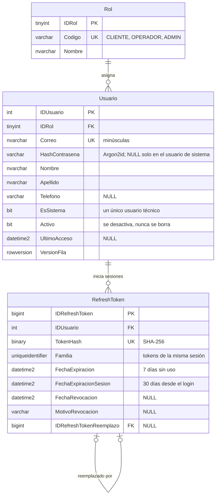
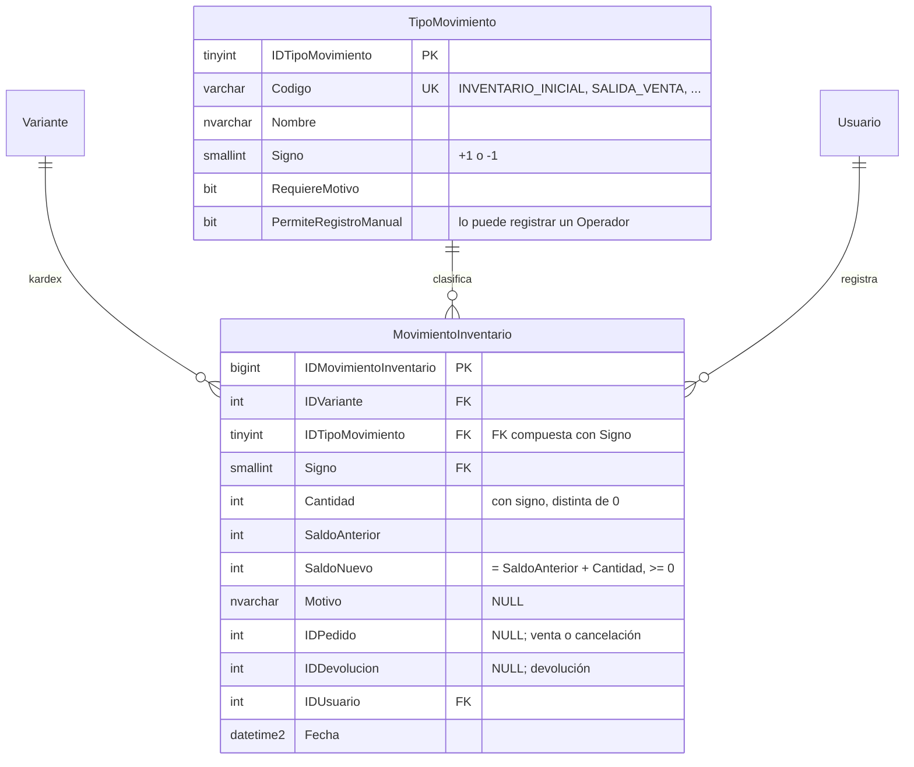
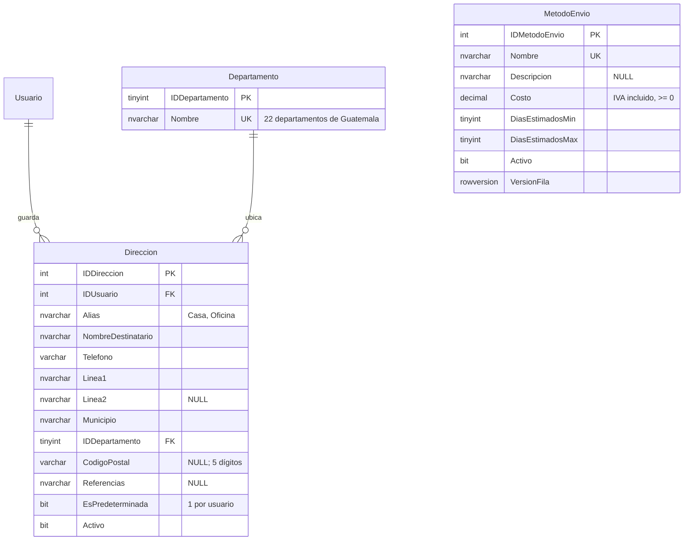
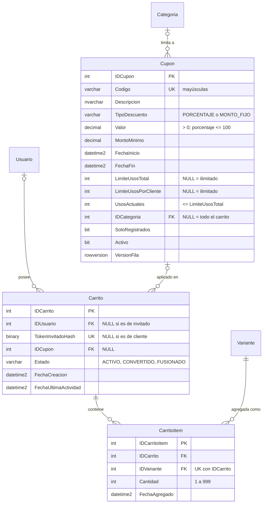
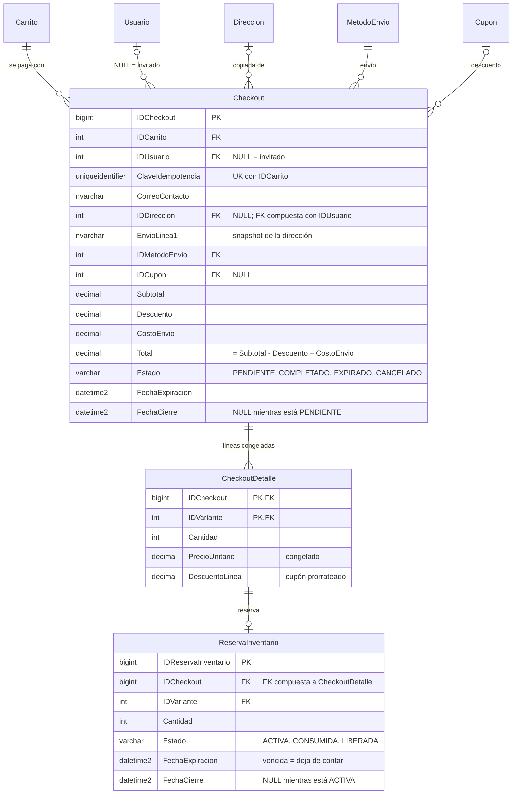
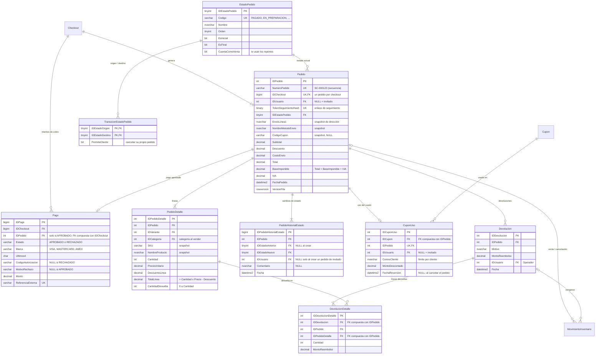
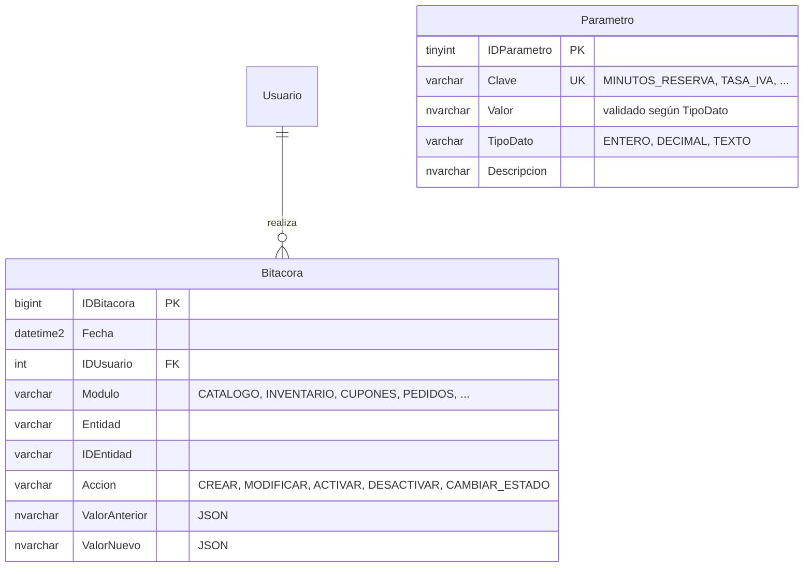

# Diagrama entidad-relación

El diagrama se divide por módulo para que sea legible. Las fechas se guardan en UTC (`DATETIME2(3)`), los montos en `DECIMAL(12,2)` y ninguna tabla usa `FLOAT` ni `REAL`.

## Seguridad

## Catálogo

## Inventario

> Existencia disponible = `Variante.ExistenciaFisica` − reservas activas no vencidas. `ReservaInventario` se documenta con el checkout.

## Direcciones y envío

## Cupones y carrito

## Checkout

## Pedidos, pagos y devoluciones

## Transversal

### Triggers

| Trigger | Garantía |
|---|---|
| `TR_Pedido_Estado` | Un pedido nace en el estado inicial; un cambio de estado solo se acepta si está en `TransicionEstadoPedido`; cada creación y cambio inserta su fila en `PedidoHistorialEstado` con el usuario tomado de `SESSION_CONTEXT`. Sin usuario identificado, el cambio se rechaza. |
| `TR_MovimientoInventario_Inmutable`, `TR_HistorialPrecio_Inmutable`, `TR_PedidoHistorialEstado_Inmutable`, `TR_Bitacora_Inmutable` | Registros de auditoría *append-only*: no admiten `UPDATE` ni `DELETE`. Un error se corrige con un registro nuevo (por ejemplo, un ajuste de inventario). |

### Reglas que garantiza la base de datos

| Regla | Mecanismo |
|---|---|
| Correo único y en minúsculas | `UQ_Usuario_Correo`, `CK_Usuario_CorreoMinusculas` (comparación binaria) |
| Nunca se guarda una contraseña en claro | `CK_Usuario_Contrasena`: solo acepta hashes Argon2id |
| Un único usuario de sistema | Índice único filtrado `UQ_Usuario_UnicoSistema` |
| Un refresh token no puede durar más que la sesión | `CK_RefreshToken_Vigencia` |
| Precio positivo y existencia nunca negativa | `CK_Variante_PrecioPositivo`, `CK_Variante_ExistenciaNoNegativa` |
| SKU único con formato | `UQ_Variante_SKU`, `CK_Variante_SKUFormato` (mayúsculas, números y guiones) |
| Sin combinaciones repetidas en un producto | `UQ_Variante_Producto_Combinacion` |
| Una variante tiene un solo valor por atributo y el valor pertenece a ese atributo | PK `(IDVariante, IDAtributo)` + FK compuesta a `AtributoValor (IDAtributo, IDAtributoValor)` |
| Una sola imagen principal por producto y color | Índice único filtrado `UQ_ProductoImagen_Principal` |
| Rutas de imagen seguras | `CK_ProductoImagen_RutaFormato` (debe estar bajo `/uploads/`, sin `..`) |
| Cada movimiento del kardex cuadra y nunca deja existencia negativa | `CK_MovimientoInventario_SaldoCuadra`, `CK_MovimientoInventario_SaldoNoNegativo` |
| El signo de la cantidad corresponde al tipo de movimiento (una venta no puede sumar existencia) | FK compuesta `(IDTipoMovimiento, Signo)` + `CK_MovimientoInventario_CantidadConSigno` |
| Una sola dirección predeterminada por cliente, y debe estar activa | `UQ_Direccion_Predeterminada`, `CK_Direccion_PredeterminadaActiva` |
| Un cupón nunca supera su límite de usos, aun con pagos simultáneos | `CK_Cupon_UsosDentroDelLimite` |
| Descuento porcentual entre 0 y 100 y vigencia coherente | `CK_Cupon_Valor`, `CK_Cupon_Vigencia` |
| Un carrito pertenece a un cliente o a un invitado, nunca a ambos ni a ninguno | `CK_Carrito_Propietario` |
| Un solo carrito activo por cliente | Índice único filtrado `UQ_Carrito_UsuarioActivo` |
| Una variante aparece una sola vez en el carrito | `UQ_CarritoItem_Carrito_Variante` |
| Repetir la misma petición de checkout no crea otro | `UQ_Checkout_Carrito_ClaveIdempotencia` |
| Un solo checkout pendiente por carrito (no se reserva dos veces) | Índice único filtrado `UQ_Checkout_CarritoPendiente` |
| Un cliente solo puede enviar a sus propias direcciones | FK compuesta `FK_Checkout_DireccionDelUsuario` |
| Solo se reserva lo que está en el checkout | FK compuesta `FK_ReservaInventario_CheckoutDetalle` |
| Un checkout produce como máximo un pedido (doble clic, reintentos simultáneos) | `UQ_Pedido_IDCheckout` |
| Nunca se cobra dos veces un checkout | Índice único filtrado `UQ_Pago_CheckoutAprobado` |
| El pago aprobado pertenece al pedido de su mismo checkout | FK compuesta `FK_Pago_PedidoDelCheckout` |
| Montos del pedido cuadran, incluido el desglose de IVA | `CK_Pedido_Totales`, `CK_Pedido_Impuestos`, `CK_PedidoDetalle_TotalLinea` |
| No se devuelve más de lo vendido por línea | `CK_PedidoDetalle_CantidadDevuelta` |
| Una línea devuelta pertenece al pedido de la devolución | FK compuestas `FK_DevolucionDetalle_Devolucion` y `FK_DevolucionDetalle_PedidoDetalle` |
| El uso de cupón corresponde al cupón registrado en el pedido | FK compuesta `FK_CuponUso_PedidoCupon` |
| Transiciones de estado válidas e historial completo | Trigger `TR_Pedido_Estado` |
| Kardex, historiales y bitácora no se pueden alterar | Triggers `TR_*_Inmutable` |
| Los parámetros son convertibles a su tipo y la bitácora guarda JSON válido | `CK_Parametro_ValorSegunTipo`, `CK_Bitacora_ValoresJSON` |
