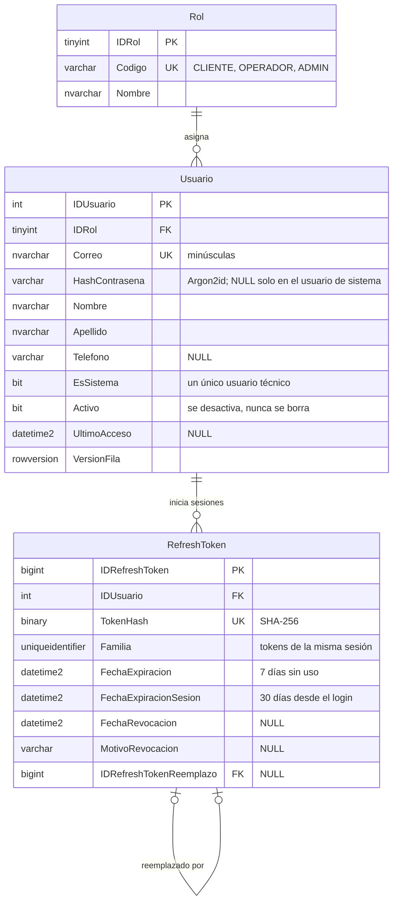
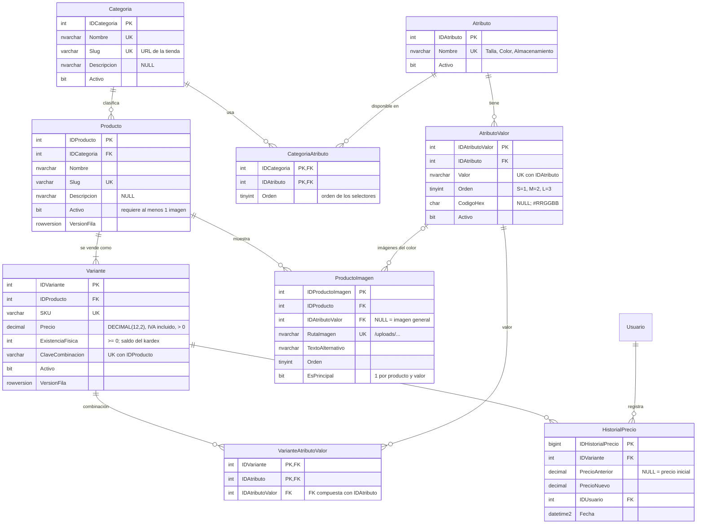
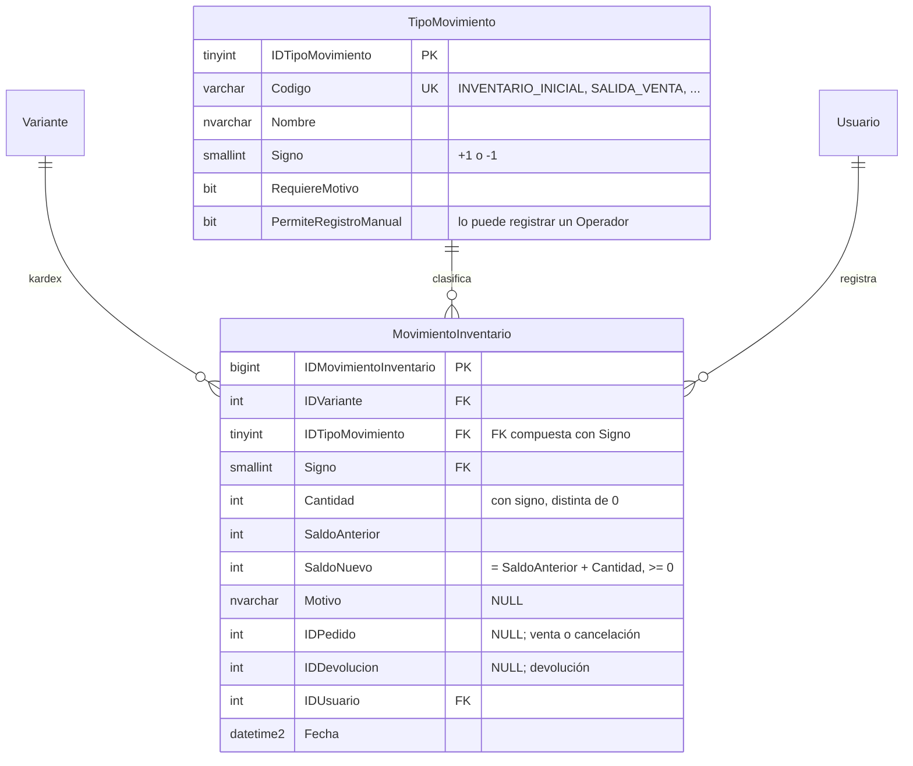
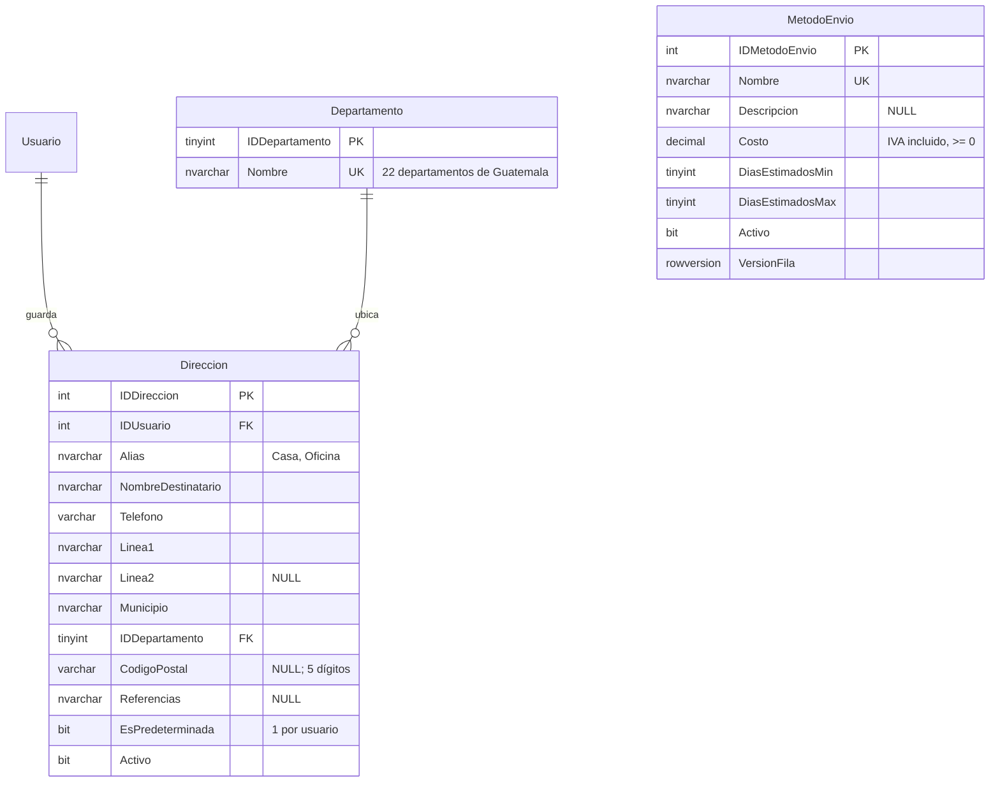
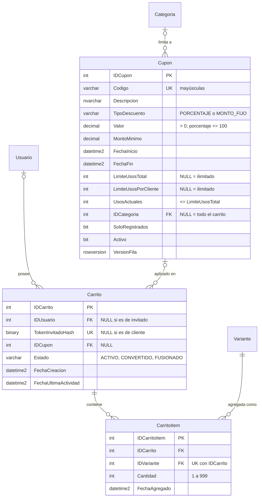

# Diagrama entidad-relación

El diagrama se divide por módulo para que sea legible. Las fechas se guardan en UTC (`DATETIME2(3)`), los montos en `DECIMAL(12,2)` y ninguna tabla usa `FLOAT` ni `REAL`.

## Seguridad

## Catálogo

## Inventario

> Existencia disponible = `Variante.ExistenciaFisica` − reservas activas no vencidas. `ReservaInventario` se documenta con el checkout.

## Direcciones y envío

## Cupones y carrito

### Reglas que garantiza la base de datos

| Regla | Mecanismo |
|---|---|
| Correo único y en minúsculas | `UQ_Usuario_Correo`, `CK_Usuario_CorreoMinusculas` (comparación binaria) |
| Nunca se guarda una contraseña en claro | `CK_Usuario_Contrasena`: solo acepta hashes Argon2id |
| Un único usuario de sistema | Índice único filtrado `UQ_Usuario_UnicoSistema` |
| Un refresh token no puede durar más que la sesión | `CK_RefreshToken_Vigencia` |
| Precio positivo y existencia nunca negativa | `CK_Variante_PrecioPositivo`, `CK_Variante_ExistenciaNoNegativa` |
| SKU único con formato | `UQ_Variante_SKU`, `CK_Variante_SKUFormato` (mayúsculas, números y guiones) |
| Sin combinaciones repetidas en un producto | `UQ_Variante_Producto_Combinacion` |
| Una variante tiene un solo valor por atributo y el valor pertenece a ese atributo | PK `(IDVariante, IDAtributo)` + FK compuesta a `AtributoValor (IDAtributo, IDAtributoValor)` |
| Una sola imagen principal por producto y color | Índice único filtrado `UQ_ProductoImagen_Principal` |
| Rutas de imagen seguras | `CK_ProductoImagen_RutaFormato` (debe estar bajo `/uploads/`, sin `..`) |
| Cada movimiento del kardex cuadra y nunca deja existencia negativa | `CK_MovimientoInventario_SaldoCuadra`, `CK_MovimientoInventario_SaldoNoNegativo` |
| El signo de la cantidad corresponde al tipo de movimiento (una venta no puede sumar existencia) | FK compuesta `(IDTipoMovimiento, Signo)` + `CK_MovimientoInventario_CantidadConSigno` |
| Una sola dirección predeterminada por cliente, y debe estar activa | `UQ_Direccion_Predeterminada`, `CK_Direccion_PredeterminadaActiva` |
| Un cupón nunca supera su límite de usos, aun con pagos simultáneos | `CK_Cupon_UsosDentroDelLimite` |
| Descuento porcentual entre 0 y 100 y vigencia coherente | `CK_Cupon_Valor`, `CK_Cupon_Vigencia` |
| Un carrito pertenece a un cliente o a un invitado, nunca a ambos ni a ninguno | `CK_Carrito_Propietario` |
| Un solo carrito activo por cliente | Índice único filtrado `UQ_Carrito_UsuarioActivo` |
| Una variante aparece una sola vez en el carrito | `UQ_CarritoItem_Carrito_Variante` |
